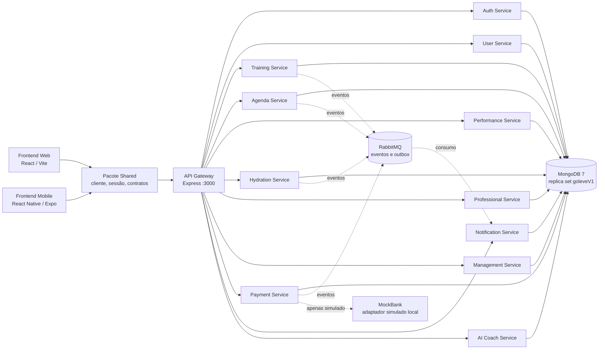
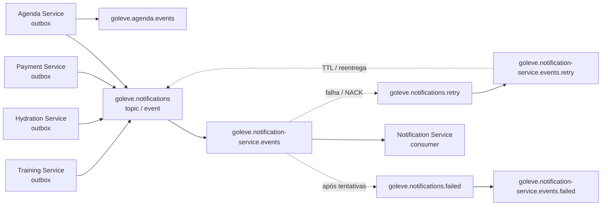
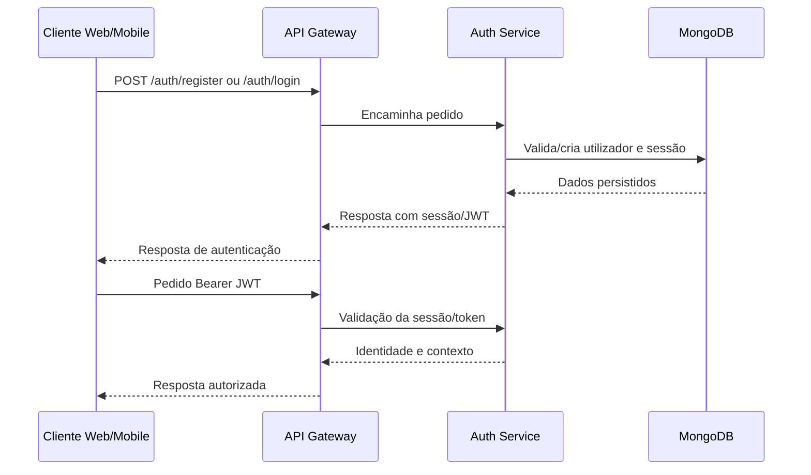
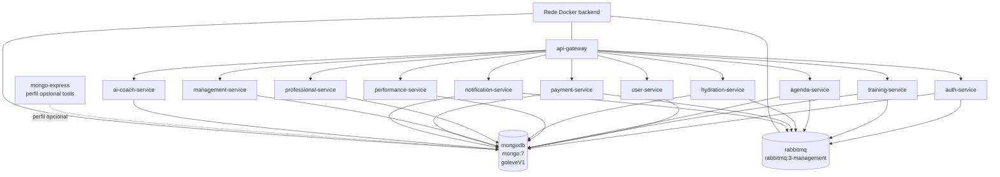
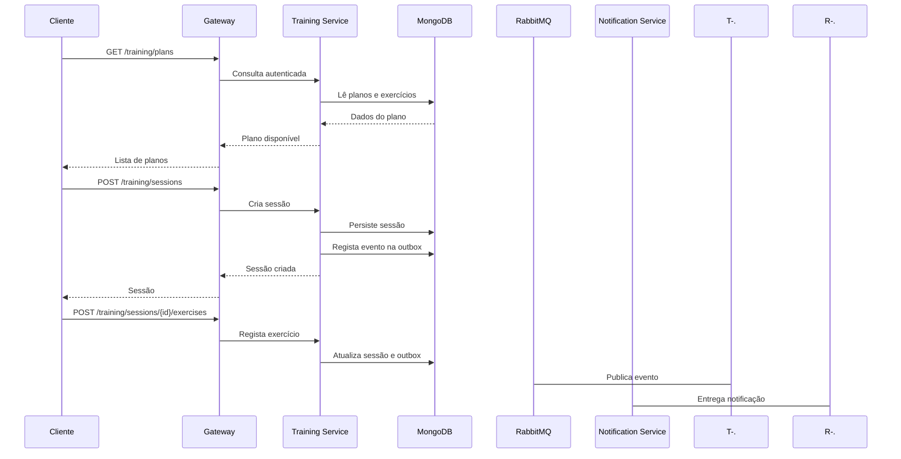
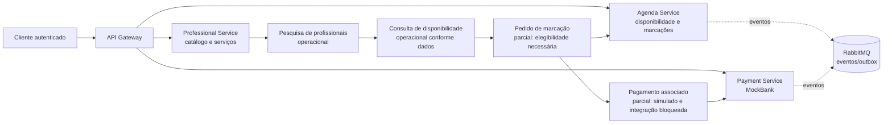

# GoLeve V1 — Arquitetura do sistema

## 1. Introdução e objetivos arquiteturais

O GoLeve V1 é uma plataforma de gestão de atividade física e serviços de
bem-estar, desenvolvida como projeto académico de Mestrado em Engenharia
Informática. A arquitetura procura separar os domínios de negócio, manter uma
fronteira HTTP única para os clientes e permitir comunicação assíncrona para
eventos que não exigem resposta imediata.

Os objetivos arquiteturais observados são:

- separar autenticação, perfil, treino, hidratação, desempenho, agenda,
  profissionais, gestão, pagamentos, notificações e AI Coach;
- expor os serviços através de um API Gateway;
- persistir os dados por serviço em MongoDB;
- propagar eventos de domínio através de RabbitMQ e padrões outbox;
- partilhar contratos de cliente e autenticação entre Web e Mobile;
- manter a documentação OpenAPI alinhada com as rotas públicas;
- aplicar autenticação, autorização por perfil, MFA e step-up onde o domínio
  exige privilégios acrescidos.

Este documento descreve a implementação existente. Não trata Kubernetes,
pagamentos bancários reais ou fornecedores externos não presentes no código como
componentes operacionais.

## 2. Visão geral da arquitetura

A solução é um monorepo com três camadas principais:

1. **Clientes:** aplicação Web, aplicação Mobile e pacote Shared;
2. **Backend:** API Gateway e 11 microserviços REST;
3. **Infraestrutura:** MongoDB, RabbitMQ e execução Docker Compose.

### Diagrama A — Arquitetura geral

As setas sólidas representam chamadas ou persistência documentadas no código.
As setas tracejadas representam publicação/consumo assíncrono. O MockBank é
um adaptador fictício de desenvolvimento; não é uma integração bancária
externa comprovada.

## 3. Padrão de microserviços

Cada domínio possui um serviço executável separado, com rotas, modelos,
serviços de aplicação e validação próprios. O API Gateway evita que os clientes
tenham de conhecer os endereços internos.

Esta separação oferece:

- isolamento de responsabilidades e de ciclos de alteração;
- possibilidade de testar cada domínio com bases e fixtures próprias;
- limites de autorização específicos;
- publicação de eventos sem acoplar diretamente todos os consumidores.

O compromisso principal é a complexidade operacional: existem mais processos,
configuração, contratos entre serviços e casos de consistência eventual do que
num monólito. A arquitetura atual continua dependente de uma topologia local
Docker e não demonstra alta disponibilidade multi-host.

## 4. Organização do backend

O backend está em [backend/](../backend/). O Gateway contém rotas públicas,
proxies, middleware de fronteira, documentação e configuração de execução. Os
serviços de domínio estão em `backend/services/`.

Os serviços seguem, com variações, uma organização semelhante:

- `src/server.ts` ou `src/app.ts` para composição HTTP;
- rotas Express;
- controladores ou serviços de domínio;
- modelos Mongoose;
- validação de entrada e tratamento de erros;
- rotas internas separadas das rotas públicas;
- testes unitários, de integração ou de mensageria conforme o domínio.

As rotas internas de gestão, demonstração e comunicação técnica não fazem parte
da fronteira pública do Gateway. O acesso entre serviços usa URLs de serviço e
credenciais técnicas configuradas no ambiente, sem expor essas credenciais aos
clientes.

## 5. Responsabilidades dos 11 microserviços

| Serviço | Responsabilidade implementada | Dependências e limites |
|---|---|---|
| Auth Service | Registo, login, sessão, JWT, MFA, step-up e operações de administração autenticada | Fluxos administrativos positivos dependem de autoridades e dados próprios; recuperação de password não está aprovada |
| User Service | Perfil, preferências, hábitos, objetivos e medições próprias | Dados locais/sintéticos; medições sensíveis têm proteção prevista |
| Training Service | Exercícios, planos, sessões, transições de estado, histórico e outbox | Não constitui prescrição clínica |
| Hydration Service | Metas, ingestões, totais, lembretes configuráveis e eventos | O disparo automático de lembretes não foi demonstrado |
| Performance Service | Medições, passos, frequência cardíaca, objetivos e evolução | A convergência de unidades com User permanece por definir |
| Agenda Service | Atividades pessoais, disponibilidade, marcações, reagendamento, cancelamento e outbox | Marcações profissionais positivas dependem de elegibilidade real |
| Professional Service | Catálogo, serviços, candidaturas, qualificações e relações profissionais | Autoridade profissional real e acompanhamento positivo não estão plenamente validados |
| Management Service | Convites, âmbitos, serviços, casos, indicadores e auditoria | Percursos positivos interserviços permanecem condicionais |
| Payment Service | Pagamentos MockBank, idempotência, confirmação, resultados incertos e outbox | Não existe pagamento bancário real nem reconciliação financeira real |
| Notification Service | Consumo de eventos, templates, preferências, deduplicação, retry/DLQ e leitura | Não envia email, SMS ou push externo |
| AI Coach Service | Conversação cifrada e ações confirmadas no módulo existente | Capacidade desativada por defeito no ambiente atual |

## 6. API Gateway

O Gateway é uma aplicação Express em
[backend/api-gateway/src/](../backend/api-gateway/src/). Publica os prefixos
de domínio e encaminha os pedidos para os serviços através de 11 proxies:

`/auth`, `/users`, `/training`, `/agenda`, `/performance`, `/hydration`,
`/professionals`, `/care-relationships`, `/management`, `/payments`,
`/notifications` e `/ai-coach`.

Também publica `/health`, `/ready` e, quando ativado por configuração, as
interfaces `/api-docs` e `/api-docs/essentials`. As rotas internas não são
publicadas como uma extensão genérica da API.

As responsabilidades do Gateway incluem:

- composição da fronteira HTTP;
- encaminhamento para URLs internas validadas;
- CORS e limites de taxa;
- autenticação/fronteira preliminar;
- bloqueio de `/internal/*`, traversal, hosts externos e credenciais em URLs;
- disponibilização do contrato OpenAPI e Swagger UI.

A autorização de negócio permanece nos serviços. O Gateway não substitui as
regras de perfil, MFA ou step-up dos domínios.

## 7. Comunicação síncrona REST

Os clientes fazem pedidos HTTP ao Gateway. O Gateway encaminha cada pedido ao
serviço correspondente, preservando o contexto de autenticação necessário e
devolvendo a resposta do domínio.

| Origem | Destino | Finalidade |
|---|---|---|
| Web/Mobile | Gateway | Operações públicas da aplicação |
| Gateway | Auth | Registo, login, sessão e autenticação |
| Gateway | User | Perfil e dados pessoais |
| Gateway | Training | Exercícios, planos e sessões |
| Gateway | Hydration | Metas e ingestões |
| Gateway | Performance | Medições e evolução |
| Gateway | Agenda | Atividades e marcações |
| Gateway | Professional | Catálogo, serviços e relações |
| Gateway | Management | Gestão autorizada |
| Gateway | Payment | Operações MockBank |
| Gateway | Notification | Notificações do utilizador |
| Gateway | AI Coach | Capacidade de coach, atualmente desativada |

As chamadas técnicas entre serviços são configuradas por variáveis de ambiente
e validadas para aceitar apenas origens HTTP(S) sem credenciais embutidas.

## 8. Comunicação assíncrona com RabbitMQ

O fluxo de notificações usa o exchange durável `goleve.notifications`, do tipo
`topic`, com routing key `event`. Os produtores usam outbox persistente para
publicar eventos de forma durável e com `mandatory`.

Os nomes observados no código são:

- exchange principal: `goleve.notifications`;
- fila de consumo: `goleve.notification-service.events`;
- exchange de retry: `goleve.notifications.retry`;
- fila de retry: `goleve.notification-service.events.retry`;
- exchange de falhas: `goleve.notifications.failed`;
- fila de falhas: `goleve.notification-service.events.failed`;
- exchange do domínio de agenda: `goleve.agenda.events`;
- fila do domínio de agenda: `goleve.agenda.professional.events`.

### Diagrama C — Comunicação assíncrona

Os eventos são envelopes validados com identificador, versão de contrato,
origem, destinatário, instante e payload. O consumidor confirma mensagens
válidas, aplica deduplicação no domínio de notificações e encaminha mensagens
inválidas ou esgotadas para a fila de falhas. Os nomes de eventos de negócio
incluem, entre outros, `hydration.daily_goal.reached.v1` e eventos de agenda
profissional como `agenda.professional.accepted.v1`; a lista canónica é
definida pelos contratos de cada serviço.

## 9. Persistência e MongoDB

Os serviços usam MongoDB através de Mongoose e mantêm os seus modelos e
coleções por domínio. A stack oficial executa MongoDB 7 com:

- replica set `goleveV1`;
- volume Docker `mongo_data`;
- publicação local em `127.0.0.1:${MONGO_PORT:-27019}`;
- healthcheck baseado em `hello` e `isWritablePrimary`.

O ambiente observado tem um único membro. O replica set fornece o modo de
execução esperado pelos serviços e pelos testes, mas não representa alta
disponibilidade real.

Há índices de unicidade, idempotência e TTL onde o domínio o requer. Sessões e
outros dados com expiração devem ser analisados considerando o instante de
criação e o TTL, não apenas a contagem atual.

## 10. Frontend Web, Mobile e Shared

### Web

A Web usa React, Vite e TypeScript. O cliente comunica apenas com o Gateway,
mantém a sessão conforme a configuração do Shared e apresenta navegação e
painéis por perfil. Existem fluxos de autenticação, perfil, treino,
hidratação, agenda, profissionais, gestão e notificações, com estados de
carregamento, erro e indisponibilidade.

### Mobile

O Mobile usa React Native e Expo. Usa navegação nativa, SecureStore para
sessão/configuração local e os mesmos contratos e cliente partilhados. A
execução num dispositivo físico não foi demonstrada na auditoria; o Gateway
oficial está publicado em loopback.

### Shared

O pacote Shared concentra cliente API, contratos, sessão, tokens, descodificação
de JWT e navegação. A Web usa `VITE_API_BASE_URL` e o Mobile usa
`EXPO_PUBLIC_API_BASE_URL`. Isto reduz divergência entre clientes, mas mantém a
necessidade de atualizar os contratos partilhados quando a API muda.

## 11. Autenticação e autorização

### Diagrama B — Autenticação

O fluxo normal usa registo, login, sessão revogável e Bearer JWT. MFA e
step-up são aplicados nos percursos que exigem segurança adicional,
especialmente operações administrativas. A autorização de recursos e perfis
continua a ser verificada pelo serviço responsável.

Não existe no contrato atual um fluxo de recuperação de password aprovado.

## 12. Segurança e proteção de dados

As medidas efetivamente presentes incluem:

- Bearer JWT e sessão persistida;
- MFA e step-up para operações privilegiadas;
- autorização por perfil e por contexto de domínio;
- CORS com origens explicitamente configuradas;
- rate limiting no Gateway;
- rejeição de hosts externos e credenciais em URLs de proxy;
- bloqueio de `/internal/*` na fronteira pública;
- validação de entrada e limites de payload;
- cifragem/proteção prevista para dados sensíveis de User e conversações do
  AI Coach;
- segredos fornecidos por configuração Docker e ficheiros locais ignorados.

O Swagger interativo só é permitido no ambiente de desenvolvimento local, com
origem loopback e configuração explícita. Não é uma autorização para produção.

## 13. Docker e infraestrutura

O ficheiro [compose.yaml](../compose.yaml) define a stack oficial com o projeto
`goleve` e a rede `backend`. Os contentores oficiais são:

- `api-gateway`;
- os 11 serviços de domínio;
- `mongodb`;
- `rabbitmq`.

`mongo-express` pertence ao perfil opcional `tools` e não faz parte dos 14
contentores oficiais do ambiente normal.

### Diagrama F — Infraestrutura Docker

Todos os serviços de domínio dependem de MongoDB e RabbitMQ no Compose; o
Gateway depende dos healthchecks dos 11 serviços. As portas publicadas no host
estão limitadas a `127.0.0.1`. Os dados persistentes estão em volumes
`mongo_data` e `rabbitmq_data`.

## 14. Contratos OpenAPI e Swagger

O contrato canónico está em
[documentation/api/backend-release-v1.openapi.json](api/backend-release-v1.openapi.json)
e contém 215 operações em 170 caminhos. O Gateway mantém:

- `/api-docs`: documentação técnica completa;
- `/api-docs/essentials`: seleção funcional derivada por allowlist explícita;
- JSON OpenAPI e scripts de inicialização correspondentes.

O modo essencial local contém 30 operações em 24 caminhos. Não inclui health,
readiness, rotas internas, operações administrativas nem AI Coach. Os schemas,
parâmetros e referências são derivados do contrato completo.

No momento documentado, o código local contém a seleção 30/24, enquanto a
imagem Docker em execução ainda servia 31/26. A documentação deve distinguir
sempre o artefacto local da imagem efetivamente construída.

## 15. Fluxos de negócio

### Diagrama D — Fluxo de treino

O fluxo representa a implementação de planos, sessões e registo de exercícios.
As notificações dependem da publicação e consumo assíncronos e não alteram a
resposta síncrona da sessão.

### Diagrama E — Serviços profissionais

O catálogo e a pesquisa são funcionalidades disponíveis. Disponibilidade e
marcações têm código, mas a aceitação positiva requer um profissional
legitimamente elegível no ambiente. O Payment Service usa MockBank e a
integração reserva→pagamento continua parcial.

## 16. Escalabilidade e disponibilidade

A separação por serviços permite escalar processos de forma independente e
RabbitMQ desacopla produtores de notificações. Os healthchecks do Compose
permitem ordenar o arranque local e detetar indisponibilidade básica.

As limitações atuais são relevantes:

- MongoDB local tem um único membro;
- RabbitMQ e os serviços estão numa única stack Docker;
- não existe prova de failover multi-host;
- limites de taxa e estado de sessão não constituem escalabilidade distribuída;
- instalação limpa, TLS, rotação de segredos e observabilidade de produção não
  foram demonstrados.

Consequentemente, a arquitetura é adequada ao ambiente académico/local-demo,
mas não deve ser apresentada como arquitetura de produção altamente disponível.

## 17. Kubernetes — arquitetura prevista versus implementação atual

Kubernetes pode ser considerado uma evolução natural para:

- Deployments separados por serviço;
- Services internos para descoberta;
- Secrets e ConfigMaps;
- StatefulSets para componentes persistentes;
- probes equivalentes aos healthchecks;
- escalabilidade horizontal e políticas de rollout.

Contudo, a implementação observada usa Docker Compose. Não foram documentados
manifests, Helm charts, operadores ou um cluster Kubernetes funcional no
repositório analisado. Kubernetes é, portanto, arquitetura prevista e não
plataforma atualmente demonstrada.

## 18. Decisões arquiteturais e respetivas justificações

| Decisão | Justificação | Compromisso |
|---|---|---|
| API Gateway único | Simplifica o endpoint dos clientes e centraliza fronteira, CORS e documentação | Pode tornar-se ponto de concentração de tráfego |
| Separação por microserviços | Isola domínios e ciclos de evolução | Aumenta configuração e testes de integração |
| MongoDB por domínio | Flexibiliza modelos e limita acoplamento de esquema | Consultas entre domínios exigem composição ou eventos |
| RabbitMQ + outbox | Reduz perda de eventos e desacopla notificações | Introduz consistência eventual, retry e DLQ |
| JWT com sessão revogável | Permite autenticação stateless no pedido e revogação controlada | Exige gestão de expiração e estado de sessão |
| OpenAPI derivado das rotas | Mantém contrato verificável e documentação reproduzível | Alterações exigem atualização e verificação do bundle |
| Web/Mobile com Shared | Evita duplicar cliente, sessão e contratos | Mudanças partilhadas afetam ambos os clientes |
| Docker Compose local | Reproduz a topologia académica com baixo custo operacional | Não fornece, por si só, HA ou orquestração multi-host |
| MockBank explícito | Permite demonstrar fluxos sem risco financeiro real | Não valida integração bancária ou reconciliação real |

## 19. Limitações conhecidas

1. A imagem Docker do Gateway estava desfasada do código local da allowlist
   Swagger essencial.
2. A aceitação positiva de marcações profissionais depende de elegibilidade
   real não provisionada no cenário normal.
3. Os percursos administrativos interserviços não estão integralmente
   validados.
4. AI Coach está desativado por defeito.
5. Recuperação de password não tem contrato aprovado.
6. Payment é exclusivamente MockBank; não há banco ou fornecedor financeiro
   real.
7. Não existem integrações externas comprovadas de email, SMS ou push.
8. MongoDB local tem um único membro e não demonstra HA.
9. Mobile físico, instalação limpa noutro host e operação de produção não foram
   demonstrados.
10. A documentação e os contratos distinguem código local, imagem construída e
    ambiente operacional; estas versões não devem ser misturadas.

## 20. Conclusão

O GoLeve V1 implementa uma arquitetura de microserviços REST com API Gateway,
persistência MongoDB, eventos RabbitMQ, clientes Web/Mobile e contratos
OpenAPI. A decomposição por domínio, o padrão outbox e a camada Shared
respondem aos objetivos de separação, integração e reutilização do projeto.

A solução está tecnicamente adequada ao ambiente local-demo e à demonstração
académica das funcionalidades validadas. A passagem a produção exigiria,
entre outros pontos, alta disponibilidade, gestão operacional de segredos,
TLS, validação dos fluxos profissionais e administrativos, integração
financeira real e ensaios de recuperação.
