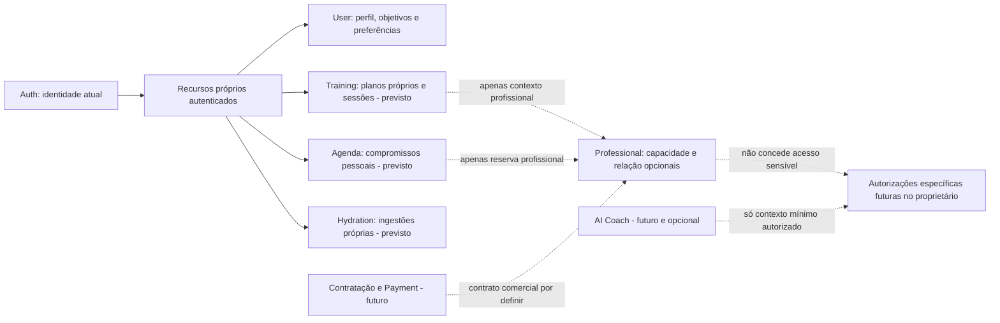

# Utilização autónoma: fronteiras e evolução dos serviços

**Âmbito:** atualização documental baseada no commit `954afa7`. As regras de produto estão em [utilização autónoma e serviços opcionais](../requirements/autonomous-use.md). Não são criados schemas, campos executáveis, endpoints, migrações, configurações ou dados nesta etapa.

## 1. Decisões definidas

O núcleo pessoal não depende de ginásio, PT, nutricionista, contratação, pagamento ou IA. Identidade e políticas de dados continuam necessárias. Percursos autónomo, acompanhado e misto são descrições funcionais por contexto; não são valores de `userType`, estados globais de perfil ou permissões.

Uma identidade pode ter zero relações ou várias relações independentes. Manter a cardinalidade N:N e a unicidade aprovada de relação aberta por utilizador/profissional/tipo. A escolha funcional de PT, nutricionista, ambos ou nenhum não limita globalmente o número de profissionais nem cria relações automaticamente.

Os ambientes ginásio, casa e exterior são contextos de treino, não organizações/tenants, filiações comerciais ou capacidades profissionais. Preferir ginásio não prova inscrição; preferir casa não autoriza recolha de morada; exterior não exige GPS. Ter uma capacidade PT não restringe o treino a ginásio.

## 2. Estado implementado e funcionalidades previstas

Estado observado por leitura de código e contratos existentes, sem executar serviços nesta revisão:

| Domínio | Implementado no backend | Previsto ou bloqueado |
| --- | --- | --- |
| Auth | Registo normal, login, JWT e identidade/papel atuais | Provisionamento administrativo e atribuição segura de papéis continuam pendentes |
| User | Perfil próprio, preferências, hábitos/janelas declaradas, medições/peso e objetivos; Mongoose, validação, versões e cifra dos payloads sensíveis | Ambientes preferidos, equipamentos por contexto e experiência de treino não estão nas allowlists atuais; grants e declarações de saúde completas não implementados |
| Professional | Candidaturas, capacidades/qualificações declaradas, horários preferidos privados, revisão simulada, catálogo condicionado e relações com histórico/expiração | Revisão desativada por defeito; sem habilitação real, profissionais elegíveis confirmados no servidor normal, consultas ou acesso sensível delegado |
| Training | Processo Express com `/health` | Planos, sessões, ambientes/contexto, duração, equipamentos e fluxos autónomos/acompanhados |
| Hydration | Processo Express com `/health` | Registos de água, totais e lembretes funcionais; um objetivo de hidratação no User não equivale a ingestões registadas |
| Agenda | Atividades pessoais e treinos planeados em `/agenda/activities`, com JWT, MongoDB, filtros, paginação e transições atómicas | Disponibilidade operacional e reservas profissionais continuam fora deste escopo |
| Payment | Processo Express com `/health` | Não há transações ou cobrança, nem sequer fluxo funcional de pagamento simulado; contratação/preços/pagamentos por definir |
| AI Coach | Processo Express com `/health` | Não há recomendações, tarefas ou contexto IA implementados; privacidade e consentimentos específicos continuam futuros |
| Gateway | Encaminha Auth, User, Professional, Management, CareRelationship e Agenda | Training, Hydration, Payment e AI Coach continuam sem rotas de negócio |

A demonstração separada tem cinco componentes reais. O fluxo de acompanhamento positivo foi testado por HTTP entre aplicações reais **dentro de testes automatizados com elegibilidade simulada**; no servidor real a aprovação permanece bloqueada. Ver [relatório da demonstração](../api/isolated-demo.md). Os 311 testes anteriormente reportados são resultados dessa entrega, não testes executados nesta revisão documental. Saúde de um processo não demonstra funções de domínio.

## 3. Responsabilidades e dados de contexto

A tabela define propriedade e intenção, não um novo contrato de persistência. Campos exatos, enums, limites e comandos futuros exigem desenho aprovado.

| Serviço | Responsabilidade no percurso autónomo ou misto | Limites e integração futura |
| --- | --- | --- |
| User | Perfil, objetivos, hábitos e medições próprios; preferências duráveis de ambientes, experiência autodeclarada e equipamento pessoal disponível por contexto, quando aprovadas | Reutiliza IDs de catálogo de equipamento do Training; não guarda planos, sessões, ingestões ou reservas. As preferências novas ainda não estão implementadas |
| Training | Catálogo de exercícios/equipamentos, compatibilidade com ambiente e material, planos/versionamento, sessões e execução | Guarda o contexto planeado e o efetivamente confirmado por sessão, com proveniência. Experiência não é inferida de papel ou filiação. Só ações de autoria profissional exigem a capacidade/relação aplicável |
| Agenda | Compromissos pessoais, intervalos planeados, fuso; futuramente disponibilidade e reservas profissionais | Não é dono da execução/duração efetiva do treino. Referências a Training não duplicam conteúdo de planos. Preferências de User/Professional não geram vagas ou reservas |
| Professional | Candidaturas, elegibilidade, relações e registos profissionais opcionais | Não guarda preferências pessoais como aprovação profissional, não exige relação para recursos próprios e não passa a ser dono de treino/agenda/medições |
| Hydration | Ingestões de água e totais derivados próprios | Objetivo pessoal fica no User; não exige ginásio ou profissional, nem cria uma prescrição clínica |
| Payment | Futuro domínio financeiro, separado do registo de acompanhamento | Contratação, preços e pagamentos não definidos. Não é consultado para desbloquear núcleo pessoal, aceitar relação ou provar elegibilidade nesta arquitetura atual |
| AI Coach | Futuras sugestões sob finalidade e contexto autorizados | Não é motor obrigatório de treinos nem autoridade sobre planos profissionais. Não cria relações, grants ou consentimentos. Funções pessoais têm de funcionar sem IA |

### Preferência, planeamento e execução

| Informação | Fonte de verdade prevista | Regra |
| --- | --- | --- |
| Ambientes preferidos e experiência declarada | User | Podem estar por preencher; pedir contexto específico quando necessário, sem default silencioso para ginásio |
| Catálogo de equipamento | Training | Identificadores/versionamento do catálogo não duplicados como catálogo autoritativo no User |
| Equipamento pessoal declarado por ambiente | User | Não implica que esse material esteja sempre disponível; confirmar para a sessão |
| Janelas habituais livres | HabitProfile no User | Já há janelas preferidas; são declarações, não disponibilidade operacional ou reservas |
| Compromisso/intervalo planeado | Agenda | Tempo livre atual deve considerar compromissos conhecidos; não garantir ausência de conflitos com informação incompleta |
| Ambiente, material, duração pretendida/planeada da sessão | Training | Contexto por sessão, distinto das preferências; pode usar uma referência Agenda |
| Ambiente confirmado e duração efetiva | Training | Registo próprio da execução; alterações futuras não reescrevem sessões concluídas |
| Horários preferidos do candidato profissional | Professional | Declaração privada já implementada; não se converte automaticamente em disponibilidade da Agenda |

Uma mudança de ambiente antes de uma sessão exige nova verificação de compatibilidade com material e tempo. Não modifica uma versão profissional emitida: alternativas e alterações desse plano precisam do seu fluxo próprio. Definir autoria (`próprio` ou `profissional`) e contexto de acesso separadamente de uma eventual origem técnica de importação/IA; uma sugestão não se torna prescrição.

Para atividades próprias não inventar profissional, capacidade, relação, ginásio ou pagamento só para satisfazer um campo obrigatório. Não é necessário preencher todos os dados de contexto no registo da conta. A relação mantém-se condicional exclusivamente ao domínio/ação profissional, não à existência de treino ou compromisso pessoal.

## 4. Dependências e autorização

Diagrama de domínios e propriedade **previsto**, não de chamadas implementadas. As linhas opcionais representam contextos autorizados; não são pré-condições universais:

Regras de falha e privacidade:

1. Autenticar cada ação privada e derivar o titular da identidade confirmada, nunca de um ID livre enviado pelo cliente.
2. Recursos exclusivamente próprios não consultam elegibilidade, relações, pagamento ou IA como autorização. A indisponibilidade desses opcionais não deve bloquear essa operação.
3. Ações profissionais exigem verificação atual de papel, capacidade e relação; se indisponível, negar a ação profissional. Não mudar o tipo de uma reserva/plano para pessoal para contornar esse controlo.
4. Aceitação de acompanhamento não dá acesso automático a peso, medições, hábitos, objetivos sensíveis ou saúde. Sem partilha específica implementada, acesso delegado permanece bloqueado.
5. Suspender/terminar acompanhamento não apaga nem bloqueia por si os recursos do titular; acesso a registos profissionais retidos segue a política própria, não uma cópia ilimitada no User.
6. Não consultar bases alheias, duplicar credenciais ou partilhar a chave JWT. As escolhas de percurso/ambiente não alteram o Auth.
7. Nenhum novo contexto é enviado a IA nesta etapa. O percurso autónomo não representa consentimento de IA nem autorização para recolha real.

## 5. Implicações para a Fase 4: Agenda

A sequência anterior designa **Fase 4 = Agenda** e **Fase 5 = Treinos/Hidratação**. A Fase 4.1 entrega a agenda pessoal independente; esta revisão não antecipa implementações de Training ou Hydration e mantém o agendamento profissional separado.

| Frente proposta para planeamento | Entrega a especificar | Pré-condições e exclusões |
| --- | --- | --- |
| 4A — Agenda pessoal | Entregue: atividades pessoais e treinos em casa/ginásio/exterior, criação/consulta/edição, conclusão/cancelamento, filtros/paginação e controlo atómico de concorrência | JWT obrigatório; sobreposições avisadas mas permitidas; datas UTC com fuso original; sem profissional, relação, IA ou pagamento obrigatório |
| Integração futura com Training | Referência a sessão/atividade planeada e contexto confirmado pelo Training | Training ainda não tem contratos de domínio; não copiar planos/execução para Agenda nem publicar uma integração fictícia na 4A |
| 4B — Disponibilidade/reservas profissionais | Calendário canónico, regras/exceções, validação de capacidade/relação, idempotência e prevenção atómica de sobreposição | Elegibilidade/provisionamento seguros e autorizações mínimas de participantes pendentes; não desbloquear por fixtures no servidor real |
| Integrações comerciais/IA | Fora desta entrega inicial de Agenda | Sem preços, cobranças, consentimentos IA ou dependências obrigatórias nesses serviços |

As frentes são proposta de divisão de trabalho, não autorização para implementar nesta tarefa. Uma tarefa pessoal de treino pode ter uma referência opcional a Training quando o contrato existir; não exige uma sessão executada nem uma reserva profissional. Uma reserva profissional deve validar as condições próprias, mesmo que uma atividade pessoal use o mesmo intervalo.

Decisões a aprovar antes do código da Fase 4:

- **AG-01:** tipos de compromisso pessoal e como distinguir, de forma não contornável, uma reserva profissional; campos/contratos e visibilidade de cada tipo.
- **AG-02:** permitir, avisar ou recusar sobreposição de compromissos pessoais e cruzamentos com treinos/reservas; não aplicar silenciosamente a regra rígida profissional à agenda pessoal.
- **AG-03:** recorrência, edição de ocorrência/série, mudanças de hora (DST), hora local inexistente/ambígua, cancelamento e lembretes; nenhuma destas regras está decidida pelo simples uso de um fuso IANA.
- **AG-04:** origem e reconciliação de duração/contexto entre Agenda e Training, margens de preparação/deslocação e alterações de sessão já iniciada.
- **AG-05:** controlo de concorrência e consistência local; um índice único no início não impede intervalos sobrepostos. MongoDB standalone não permite prometer transações multidocumento sem outra decisão.
- **AG-06:** identidade/contratos mínimos de participantes e gates de elegibilidade/partilha para 4B. A agenda pessoal não deve ficar dependente de resolver todo o provisionamento profissional.

Saída verificável: critérios CA-A13–CA-A15 do [documento funcional](../requirements/autonomous-use.md), testes entre titulares, fuso/DST, concorrência, preservação de autoria e falhas dos opcionais. Reservas profissionais só podem ser consideradas entregues depois de validar os seus próprios gates; `/health` não basta.

## 6. Conflitos e decisões anteriores

| Referência anterior | Conflito ou lacuna encontrada | Tratamento documental nesta etapa |
| --- | --- | --- |
| README de requisitos centrado em marketplace/aprovação | Pode sugerir que acompanhamento é a entrada obrigatória no produto | Núcleo autónomo explícito; serviços profissionais opcionais |
| Agenda só com `Appointment` e IDs profissionais obrigatórios em `profile-relationships.md` | Não representa compromissos pessoais sem profissional | Requisitos separados para agenda pessoal; não tornar os IDs opcionais num contrato profissional existente |
| Fase 4 com dependência genérica de relações/capacidades | Bloquearia também a agenda própria à espera da aprovação profissional | Dependência apenas na frente profissional; frente pessoal independente, ainda por especificar |
| Plano de treino autodirigido já admitido no desenho | Compatível com autonomia, mas faltavam ambientes, equipamento e os três percursos | Complemento funcional/contextual, sem mudar autoria nem ownership |
| `TrainingPlan` descrito com capacidade PT sem condição explícita | Poderia obrigar planos próprios a ter capacidade profissional | Capacidade/relação apenas para autoria profissional; schemas de treino continuam futuros |
| Desenho antigo afirma que User/Professional só têm `/health`, gateway só Auth e relações inexistentes | Desatualizado face às entregas posteriores | Resumos de estado corrigidos e referências aos contratos executados; tabelas futuras não se tornam modelos implementados |
| Relações desenhadas com suspensão/revogação, histórico separado e unicidade por capacidade | Diverge das decisões aprovadas na Fase 3 | Contrato atual prevalece: estados limitados, 8 eventos embebidos, expiração passiva, unicidade por tipo; não reintroduzir transições/índices antigos |
| Declaração de horários no Professional | Risco de a usar como disponibilidade para agenda pessoal ou reservas | Continua privada e não operacional; disponibilidade canónica é Agenda |
| Pagamentos anteriormente descritos como simulados | Poderia sugerir transações simuladas já implementadas | Só existe `/health`; princípio de ausência de cobrança real preservado, produto comercial por definir |
| Matriz de acesso baseada em relações/capacidades | Risco de aplicar requisitos profissionais a qualquer ação do próprio | Titularidade separada de delegação; não enfraquecer controlos de dados alheios |

Não há conflito entre opcionalidade e verificação profissional obrigatória **quando** se escolhe uma ação profissional. A nova regra também não autoriza remover políticas de saúde, emitir privilégios ou ativar o contrato de demonstração em produção.

## 7. Decisões pendentes além da Agenda

| ID | Decisão | Impacto |
| --- | --- | --- |
| AUT-D01 | Vocabulário/versão de ambientes e equipamento; representação de listas vazias, desconhecidas e disponibilidade por sessão | User/Training; sem inferir material a partir do ambiente |
| AUT-D02 | Níveis de experiência, duração/unidades, limites técnicos e regras de compatibilidade/apresentação de alternativas | Training; não inventar recomendações clínicas ou duração padrão |
| AUT-D03 | Mudanças durante execução, múltiplos ambientes na mesma sessão e correções históricas | Training/Agenda; preservar contexto e autoria |
| AUT-D04 | Conteúdo mínimo, aceitação e adaptação de planos próprios/profissionais e sugestões futuras | Training/Professional; não editar silenciosamente versões emitidas |
| AUT-D05 | Provisionamento seguro, verificação/validade e autorizações específicas de partilha | Professional/Auth/User; bloqueia atendimento real, não o núcleo pessoal |
| AUT-D06 | Contratação, preços, responsabilidades, cancelamentos e pagamentos | Payment/Professional; nenhuma cobrança ou promessa de gratuitidade definida |
| AUT-D07 | Privacidade dos novos contextos e tratamento real; IA, fornecedores e consentimentos numa fase própria | Todos os domínios; manter âmbito fictício e IA sem ativação |

Os contratos e eventos de integração destes novos requisitos permanecem por definir. A documentação de eventos existente continua uma lista de intenções, sem publicação/consumo implementados. Esta etapa não muda ordem de implementação, permissões, limites da demonstração ou decisões já aprovadas da Fase 3.
