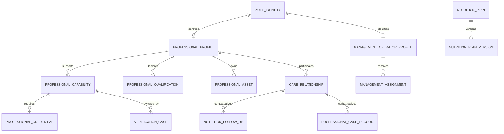

# Perfis profissionais e de gestão

**Estado: desenho evolutivo; candidaturas e revisão simulada parcialmente implementadas. Esta revisão é apenas documental.**
Usa tipos, campos comuns, sensibilidade P0/P1/P2/S e obrigatoriedade O/F/C de [user-profiles.md](user-profiles.md). Complementa [relações](profile-relationships.md) e [permissões](profile-permissions.md).

## 1. Fronteiras e compatibilidade

O Professional já tem Mongoose, perfis/capacidades/qualificações declaradas, horários preferidos privados, candidatura/revisão simulada e relações com histórico. O Management encaminha revisão para o proprietário. Os contratos atuais estão em [fase 1](../api/professional-service.md), [fase 2](../api/professional-applications.md) e [relações](../api/care-relationships.md). Credenciais oficiais, verificação real, disponibilidade operacional, consultas e planos descritos abaixo continuam futuros. A revisão mantém-se desativada por defeito e a aprovação simulada não prova elegibilidade real.

O acompanhamento é opcional: nenhum, PT, nutricionista ou ambos. A ausência, recusa ou terminação de uma relação não bloqueia o núcleo pessoal. Treinos em ginásio, casa ou exterior não exigem PT nem inscrição; modalidades profissionais `online/in_person/home_visit` não são os ambientes de treino do utilizador. Ver [requisitos](../requirements/autonomous-use.md) e [implicações por serviço](autonomous-use.md).

Proposta: **ProfessionalProfile comum + ProfessionalCapability por atividade + credenciais e verificações separadas**. A mesma identidade pode ser nutricionista e PT, mantendo a verificação independente de cada atividade/país. Não criar dois modelos de login nem duplicar a pessoa em duas contas.

O papel Auth `profissional` é condição necessária para exercer acompanhamento, mas não suficiente: também são necessárias capacidade ativa, verificação aplicável, relação aceite e autorização específica. Criar ou preencher o perfil profissional não muda `AuthUser.userType`. Um utilizador normal pode preparar uma candidatura; não pode ativá-la nem marcar-se verificado.

A promoção controlada de papéis ainda não existe no Auth. Este documento **não a implementa**: o fluxo de aprovação deve ser validado separadamente antes de habilitar profissionais, gestores e administradores. Um profissional pode continuar a usar as funcionalidades pessoais pelo seu próprio `authUserId`.

## 2. ProfessionalProfile — `professional_profiles`, proprietário Professional

Um perfil por identidade; sem listas de clientes, consultas, documentos de prova ou históricos embebidos.

| Campo | Tipo | Req. | Sens. | Regra |
|---|---|---|---|---|
| `authUserId` | AuthId | O | P1 | Único e imutável; nunca devolvido no diretório público |
| `professionalName` | string | O | P0 condicionado | Trim, 2–150; publicação só após aprovação |
| `photoAssetId` | Id | F | P0 condicionado | ProfessionalAsset próprio, aprovado e destinado a fotografia pública |
| `biography` | string | F | P0 condicionado | Texto simples, máximo 2 000; sem notas de utentes, HTML livre ou dados de terceiros |
| `publicContacts.email` | string | F | P0 condicionado | Contacto profissional próprio, verificado e explicitamente publicado; distinto do email de login |
| `publicContacts.phoneE164` | string | F | P0 condicionado | Contacto profissional; publicação separada e opt-in |
| `privateContactEmail` | string | F | P1 | Comunicações internas; não sincronizar automaticamente com email Auth |
| `countryCode` | string | O | P0 condicionado | ISO alpha-2; jurisdição principal de prestação |
| `serviceRegions` | string[] | F | P0 condicionado | Máximo 20 códigos aprovados; sem morada residencial |
| `languages` | string[] | O | P0 condicionado | 1–10 códigos BCP 47 suportados |
| `profileStatus` | Enum | O | P1 | `draft, submitted, active, suspended, archived` |
| `directoryVisibility` | Enum | O | P1 | `hidden, public`; default hidden |
| `publishedAt` | Instant | C | P1 | Só workflow aprovado pode preencher |
| `publicationVersion` | Int | O | P1 | Versão do DTO público aprovado |
| `moderationReasonCode` | Enum | F | P1 | Código operacional; detalhes de revisão ficam privados no caso |

Índices: `authUserId` único; `profileStatus, directoryVisibility, countryCode, _id` para diretório filtrado. DTO público apenas para `active + public` e com pelo menos uma capacidade elegível. Não devolver AuthId, revisão, provas, estado interno detalhado ou contacto privado.

Publicação é uma ação do workflow, distinta da verificação de credenciais e da atribuição de papel. Suspender o perfil bloqueia novas ações profissionais, mas não apaga a identidade pessoal nem os registos anteriores.

## 3. ProfessionalCapability — `professional_capabilities`

Uma capacidade por `professionalId + kind + jurisdictionCountry`, evitando que uma aprovação de nutrição autorize treino ou outro país.

| Campo | Tipo | Req. | Sens. | Regra |
|---|---|---|---|---|
| `professionalId` | Id | O | P1 | Perfil local existente |
| `kind` | Enum | O | P0 condicionado | `nutritionist, personal_trainer` |
| `jurisdictionCountry` | string | O | P0 condicionado | ISO alpha-2 |
| `specializations` | string[] | F | P0 condicionado | Máximo 20 códigos de catálogo; não provar habilitação apenas por escolher uma especialização |
| `experienceStartYear` | Int | F | P0 condicionado | Ano passado/presente; distinguir experiência declarada e verificada |
| `serviceModes` | Enum[] | O | P0 condicionado | 1–3 de `online, in_person, home_visit`; políticas locais podem restringir |
| `titleRequirement` | Enum | O | P1 | `required, not_required, pending_legal_assessment`; determinado por política/revisor, não pelo candidato |
| `requirementPolicyVersion` | string | O | P1 | Regra por atividade, país e modalidade |
| `primaryCredentialId` | Id | C | P1 | Obrigatório quando título/cédula exigido |
| `status` | Enum | O | P1 | `draft, pending, verified, suspended, expired, rejected` |
| `verifiedAt, verifiedByOperatorId` | Instant / ExternalId | C | P1 | Necessários para verified; revisor autorizado e diferente do candidato |
| `nextReviewAt` | Instant | C | P1 | Obrigatório para capacidade elegível, mesmo que credencial não tenha fim conhecido |
| `suspendedAt, reasonCode` | Instant / Enum | C | P1 | Obrigatórios em suspensão; sem exposição de documentos internos |

Índice único `professionalId, kind, jurisdictionCountry`. Índice `status, nextReviewAt, _id` para revisões. A elegibilidade é calculada no pedido a partir do perfil, capacidade, papel e validade das credenciais; um worker atrasado não prolonga uma licença expirada.

### Nutricionista

- Cédula/número profissional, entidade emissora e jurisdição são representados em ProfessionalCredential, não no Auth.
- Qualificações, especializações, experiência, biografia e modalidades estão nos modelos comuns acima.
- Disponibilidade/agenda vêm do Agenda; utentes vêm de CareRelationship; consultas realizadas são vistas de Appointment e NutritionFollowUp.
- Planos alimentares e notas pertencem ao contexto nutricional do Professional, com acesso restrito e histórico versionado.
- A aplicabilidade das regras e do ato profissional deve ser confirmada na [Ordem dos Nutricionistas](https://www.ordemdosnutricionistas.pt/) e nas jurisdições de prestação; não considerar um upload como prova suficiente.

### Personal Trainer

- Título profissional quando aplicável, certificações e qualificações ficam em ProfessionalCredential/ProfessionalQualification.
- As modalidades, especializações e jurisdição determinam a política de validação; `pending_legal_assessment` não permite atender.
- Disponibilidade e agenda pertencem ao Agenda; clientes a CareRelationship; planos e sessões a Training; avaliações físicas a Performance.
- Em Portugal, o IPDJ descreve o [Título Profissional de Técnico de Exercício Físico](https://ipdj.gov.pt/tecnico-de-exercicio-fisico). Não generalizar esse enquadramento a todos os países, títulos ou modalidades; a política aplicável exige confirmação.
- Uma certificação de treino não concede competência de diagnóstico, prescrição nutricional ou leitura irrestrita de dados de saúde.

## 4. ProfessionalCredential — `professional_credentials`

Identifica uma cédula/título alegado por um candidato; diferentes revisões não devem duplicar a credencial da mesma pessoa.

| Campo | Tipo | Req. | Sens. | Regra |
|---|---|---|---|---|
| `professionalId, capabilityId` | Id | O | P1 | Vínculos locais coerentes |
| `credentialType` | Enum | O | P1 | `nutrition_registration, exercise_title, training_certification, other_regulated_title` |
| `issuerCode` | string | O | P1 | Autoridade/entidade num catálogo revisto |
| `jurisdictionCountry` | string | O | P1 | País do título; não inferir portabilidade internacional |
| `registrationNumberEncrypted` | envelope | C | P1 restrito | Quando o título tem número; máximo lógico 100, formato por emissor |
| `numberFingerprint` | string | C | P1 restrito | HMAC de país/emissor/tipo/número normalizado, para deteção de duplicados; chave fora da DB |
| `issuedOn` | LocalDate | F | P1 | Quando conhecido |
| `validUntil` | LocalDate | F | P1 | Só quando aplicável; ausência não significa validade ilimitada |
| `status` | Enum | O | P1 | `declared, under_review, verified, rejected, expired, revoked` |
| `latestVerificationCaseId` | Id | F | P1 | Referência a caso, não array de histórico |
| `verifiedAt, checkedAgainst` | Instant / string | C | P1 | Para verified; referência da fonte de confirmação |
| `nextCheckAt` | Instant | C | P1 | Necessário após verificação |
| `evidenceAssetIds` | Id[] | F | P1 restrito | Máximo 10 provas desse pedido; cada prova tem política própria |

Índices: `professionalId, capabilityId, status`; `status, nextCheckAt, _id`; único parcial `jurisdictionCountry, issuerCode, credentialType, numberFingerprint` para `status=verified` e fingerprint existente. Pedidos ainda não verificados não podem bloquear a cédula legítima de outra pessoa. Uma colisão na verificação vai para revisão, sem divulgar quem usa a credencial.

Não criar índice de unicidade diretamente sobre ciphertext aleatório. O fingerprint permite apenas igualdade controlada e também merece proteção; a rotação da chave requer plano de migração futuro aprovado. Não publicar o número profissional automaticamente: publicação e eventual consulta pública do registo são decisões distintas.

## 5. ProfessionalQualification — `professional_qualifications`

Um diploma/certificação por documento, sem arrays ilimitados no perfil.

| Campo | Tipo | Req. | Sens. | Regra |
|---|---|---|---|---|
| `professionalId` | Id | O | P1 | Dono do perfil |
| `capabilityId` | Id | F | P1 | Se específica de uma atividade |
| `qualificationType` | Enum | O | P1 | `degree, certification, continuing_education` |
| `title, issuerName` | string | O | P1 | 2–200; nomes declarados, não validação automática |
| `awardedOn, expiresOn` | LocalDate | F | P1 | Ordem temporal válida |
| `specializationCodes` | string[] | F | P1 | Máximo 10 códigos existentes |
| `evidenceAssetId` | Id | F | P1 restrito | Prova privada |
| `verificationStatus` | Enum | O | P1 | `unverified, verified, rejected`, só revisor altera |
| `publishSummary` | boolean | O | P1 | Default false; só resumo aprovado é P0 |

Índices `professionalId, awardedOn, _id` e `capabilityId, verificationStatus`. Certificações complementares não substituem o título obrigatório da atividade.

## 6. VerificationCase e ProfessionalAsset

`professional_verification_cases`: uma avaliação por submissão/renovação. Casos concluídos são imutáveis; uma renovação abre outro caso.

| Campo | Tipo | Req. | Sens. | Regra |
|---|---|---|---|---|
| `professionalId, capabilityId` | Id | O | P1 | Candidato e atividade |
| `credentialIds` | Id[] | O | P1 | 1–10 credenciais na submissão |
| `caseType` | Enum | O | P1 | `initial, renewal, recheck, appeal` |
| `status` | Enum | O | P1 | `submitted, assigned, needs_information, approved, rejected, cancelled` |
| `submittedAt` | Instant | O | P1 | Determinado pelo servidor |
| `assignedOperatorId` | ExternalId | F | P1 | Operador com atribuição de revisão no Management |
| `decisionByOperatorId, decidedAt` | ExternalId / Instant | C | P1 | Obrigatórios na decisão; proibir autoaprovação |
| `decisionReasonCode` | Enum | C | P1 | Motivo controlado, obrigatório na decisão |
| `privateRationaleEncrypted` | envelope | F | P1 restrito | Máximo lógico 2 000; sem dados de utentes |
| `evidenceSnapshotIds` | Id[] | O | P1 restrito | Máximo 10; versões das provas que suportaram a decisão |
| `policyVersion` | string | O | P1 | Critério de verificação utilizado |
| `previousCaseId` | Id | F | P1 | Renovação/recurso, sem reescrever a decisão anterior |

Índices `status, submittedAt, _id`; `professionalId, capabilityId, submittedAt desc`; `assignedOperatorId, status`. O Management gere a fila operacional, mas o estado canónico de verificação pertence ao Professional.

`professional_assets`: `professionalId` O, `purpose: avatar_public | credential_evidence | qualification_evidence` O, `objectKey` O, `mimeType` O, `byteSize` O, `checksum` O, `status: pending_scan | available | rejected | deletion_pending` O, `expiresAt` C para temporários; campos comuns. Provas são P1 restrito e nunca reutilizadas como avatar público. Fotografias passam por moderação e remoção de metadados. Índice `professionalId, purpose, createdAt, _id`. Documentos num object store privado e encriptado, não em URLs permanentes na DB.

## 7. Acompanhamento nutricional e notas

Estes são registos de saúde, separados da biografia, da agenda e dos documentos de verificação.

### NutritionFollowUp — `nutrition_follow_ups`

| Campo | Tipo | Req. | Sens. | Regra |
|---|---|---|---|---|
| `subjectAuthUserId` | AuthId | O | P2 | Utente |
| `professionalId, capabilityId, relationshipId` | Id | O | P2 | Nutricionista elegível e relação aceite |
| `appointmentId` | ExternalId | F | P2 | Agenda; atendimento não é inferido apenas da existência de reserva |
| `occurredAt` | Instant | O | P2 | Data da consulta efetiva |
| `status` | Enum | O | P2 | `draft, finalized, amended, restricted_archive` |
| `recordedByAuthUserId` | AuthId | O | P2 | Autor, determinado pelo servidor |
| `professionalRecordId` | Id | F | P2 | Nota associada, autorizada separadamente |
| `nutritionPlanVersionId` | Id | F | P2 | Plano exato discutido/entregue |
| `finalizedAt` | Instant | C | P2 | Obrigatório se finalizado |
| `amendsFollowUpId` | Id | F | P2 | Retificação sem eliminar a consulta anterior |

Índices `subjectAuthUserId, occurredAt desc, _id`; `professionalId, occurredAt desc, _id`; `relationshipId, status`. Conteúdo clínico não vai para Appointment nem notificações.

### ProfessionalCareRecord — `professional_care_records`

| Campo | Tipo | Req. | Sens. | Regra |
|---|---|---|---|---|
| `subjectAuthUserId, professionalId, capabilityId, relationshipId` | IDs | O | P2 | Escopo fixo do registo |
| `recordType` | Enum | O | P2 | `nutrition_note, training_note, consultation_summary` |
| `contentEncrypted` | envelope | O | P2 | Texto lógico máximo proposto de 10 000; não HTML livre |
| `visibility` | Enum | O | P2 | `subject_summary, professional_working_note`; não é dispensa dos direitos RGPD |
| `occurredAt, authoredAt` | Instant | O | P2 | Evento e registo |
| `authorAuthUserId` | AuthId | O | P2 | Não editável pelo cliente |
| `status` | Enum | O | P2 | `draft, finalized, amended, restricted_archive` |
| `replacesRecordId` | Id | F | P2 | Correção por nova versão; preservar autoria e fundamento |
| `retentionPolicyId, legalBasisPolicyId` | ExternalId | O | P2 | Política aprovada para aquele contexto |

Índices `subjectAuthUserId, recordType, occurredAt desc, _id` e `professionalId, relationshipId, occurredAt`. Sem pesquisa global sobre o texto. A categoria de registo limita a capacidade do autor; PT não cria uma nota de ato nutricional.

Notas de trabalho não são visíveis no diretório ou a outros profissionais por defeito. A visualização no produto e um pedido legal de acesso do titular são processos diferentes: não prometer exclusão absoluta de notas dos direitos do titular. Após revogação, acesso operacional cessa; eventual conservação obrigatória exige arquivo restrito e fundamento validado, não um bypass de perfil.

### NutritionPlan e NutritionPlanVersion

| Entidade / campos | Req. e tipos | Regra |
|---|---|---|
| NutritionPlan `_id, subjectAuthUserId, professionalId, capabilityId, relationshipId` | IDs O + campos comuns | Agregado P2 pertencente ao Professional |
| `status, currentVersionId` | Enum `draft, active, paused, closed` O; Id C quando ativo | Ativar versão exige profissional elegível e aceitação prevista no acompanhamento |
| NutritionPlanVersion `planId, versionNumber, authoredBy, authoredAt` | Id, Int, AuthId, Instant O | Versão final imutável; índice único planId/versionNumber |
| `contentEncrypted, formatVersion` | envelope e string O | Plano estruturado de refeições/orientações; schema de conteúdo revisto por especialistas na fase de nutrição |
| `validFrom, validUntil, acceptedAt` | Instant F | Validade e aceitação explícitas; sem recomendar quantidades neste desenho |
| `status` | Enum `draft, issued, withdrawn` O | Uma versão retirada não desaparece silenciosamente |

Índice NutritionPlan `subjectAuthUserId, status, updatedAt`; versões paginadas por `planId, versionNumber`. O contrato de conteúdo alimentar será validado no domínio de nutrição antes de implementação; não inventar cálculos clínicos no perfil.

## 8. Ligações do PT a treino e avaliação

| Entidade canónica | Proprietário / contrato mínimo proposto |
|---|---|
| TrainingPlan / TrainingPlanVersion | Training: ID, autor AuthId, versão, formato, conteúdo limitado e estado; capacidade PT para autoria profissional e relação quando houver acompanhamento de um titular, sem as inventar em planos próprios; versões emitidas imutáveis |
| TrainingAssignment | Training: subjectAuthUserId, planVersionId, professionalId/capabilityId/relationshipId se profissional, startsOn/endsOn e estado de aceitação/execução |
| TrainingSession | Training: subjectAuthUserId, assignmentId F, performedAt, durationSeconds F, source e appointmentId F; uma sessão por documento |
| PhysicalAssessment | Performance: subjectAuthUserId, professionalId/capabilityId/relationshipId, assessedAt, instrumentCode, formatVersion, payload encriptado e proveniência |
| Agendamento de sessão | Agenda: compromisso próprio sem profissional/relação; reserva profissional exige participantes, capacidade/relação, atividade e intervalo; sem métricas físicas ou notas |

São P2 e exigem autorização, mesmo quando o conteúdo é apenas uma duração ou uma avaliação derivada. Em recursos próprios, titularidade e política local não exigem relação; em ações profissionais aplicam-se os controlos adicionais. O Professional não persiste cópias dos planos de treino, avaliações ou histórico de sessões: apresenta vistas autorizadas. Ambientes/equipamento e duração por sessão pertencem ao Training; preferências duráveis ao User. Contratos completos de execução e métricas pertencem à futura fase 5, sem alterar esta propriedade.

## 9. ManagementOperatorProfile — `management_operator_profiles`

Proprietário Management. Não é uma segunda conta de login.

| Campo | Tipo | Req. | Sens. | Regra |
|---|---|---|---|---|
| `authUserId` | AuthId | O | P1 | Único |
| `displayName` | string | O | P1 | Nome operacional 2–150; identidade legal continua no respetivo contexto |
| `workContactEmail` | string | F | P1 | Contacto profissional, não email de login |
| `operatorStatus` | Enum | O | P1 | `invited, active, suspended, archived` |
| `onboardingApprovedAt` | Instant | F | P1 | Só processo administrativo |

Índice único authUserId. Uma atribuição operacional só é eficaz se o papel global devolvido pelo Auth for compatível. Não há gestor ou administrador criado por registo público.

### ManagementAssignment — `management_assignments`

| Campo | Tipo | Req. | Sens. | Regra |
|---|---|---|---|---|
| `operatorProfileId` | Id | O | P1 | Operador local |
| `assignmentType` | Enum | O | P1 | `operations_manager, professional_reviewer, scheduling_manager, security_administrator` |
| `scope.kind` | Enum | O | P1 | `service, organisation, region, platform`; platform apenas para administração aprovada |
| `scope.ids` | string[] | C | P1 | 1–50 IDs conhecidos, salvo plataforma; nunca wildcard enviado pelo cliente |
| `permissions` | Enum[] | O | P1 | Lista de catálogo, máximo 30; não incluir saúde clínica genérica |
| `validFrom, validUntil` | Instant | O | P1 | Prazo finito e coerente |
| `status` | Enum | O | P1 | `pending, active, revoked, expired` |
| `requestedBy, approvedBy` | AuthId | O | P1 | Separação de funções; nunca autoaprovação ou autopromoção |
| `revokedAt, reasonCode` | Instant / Enum | C | P1 | Na revogação |

Índices `operatorProfileId, status, validUntil` e `scope.kind, status`. Organizações/tenants são uma extensão ainda inexistente: scopes organisation ficam desativados até existir um identificador e isolamento de tenant canónicos. Gestão por serviço/região só usa recursos reais do catálogo.

### OperationalCase, PlatformSetting e SecurityAuditRecord

| Modelo | Campos propostos | Limites |
|---|---|---|
| OperationalCase | `caseType` enum professional_review/scheduling_issue/account_request; `resourceOwnerService, resourceId, scopeRef, assignedOperatorId, status, reasonCode, createdAt, version` O; `closedAt` C | Sem cópias de provas ou notas clínicas; a decisão de verificação é gravada no Professional e contas/papéis no Auth |
| PlatformSetting | `key` de catálogo, `value` validado, `scopeRef, version, updatedBy, approvedBy, updatedAt` O | Só configuração não secreta; JWT_SECRET, passwords, chaves KMS e tokens ficam num gestor de segredos |
| SecurityAuditRecord | `actorId, actionCode, resourceOwnerService, resourceOpaqueId, occurredAt, result, requestId, scopeRef` O; `reasonCode` F | Metadados restritos, não payloads clínicos ou credenciais; índices actorId/occurredAt e resourceOpaqueId/occurredAt |

O gestor pode gerir profissionais e agendamentos **no seu âmbito**, mediante atribuição. Não altera papéis globais, não acede a saúde por função e não lê todos os clientes. O administrador gere processos de conta, permissões, configurações e segurança através das APIs dos proprietários; também não recebe acesso clínico automático. A matriz detalhada está em [profile-permissions.md](profile-permissions.md).

### OperationalMetricSnapshot — `operational_metric_snapshots`

Projeção de indicadores no Management, não uma segunda fonte de verdade de consultas ou de saúde. Um documento por métrica, âmbito e período, separado do perfil do gestor.

| Campo | Tipo | Req. | Sens. | Regra |
|---|---|---|---|---|
| `metricCode` | Enum | O | P1 restrito | Catálogo inicial: `professional_reviews_pending, appointments_confirmed, appointments_cancelled, service_requests_failed` |
| `scopeKey, sourceService` | string | O | P1 restrito | Âmbito canónico e proprietário da origem; filtro de âmbito obrigatório |
| `periodStart, periodEnd` | Instant | O | P1 restrito | Intervalo positivo, unidade de agregação aprovada |
| `value` | Int | C | P1 restrito | Não negativo; omitido se suppressed=true |
| `suppressed` | boolean | O | P1 restrito | Aplicar política de supressão de células/grupos pequenos antes da resposta |
| `aggregationPolicyId` | ExternalId | O | P1 restrito | Define métricas, granularidade e limiar aprovado; não afirmar anonimato apenas por agregar |
| `sourceVersion, computedAt` | string / Instant | O | P1 restrito | Proveniência e atualidade; projeção reconstruível |

Índice único `metricCode, scopeKey, periodStart, periodEnd` e índice `scopeKey, computedAt`. Não guardar AuthIds de utentes, pesos, patologias, notas ou razões clínicas de cancelamento. A autorização M restringe o âmbito antes de consultar; o dashboard não permite drill-down clínico. Métodos de agregação e supressão são decisão de produto/privacidade antes da ativação.

## 10. Dados públicos, privados e autorizados

| Classe de vista | Conteúdo permitido | Conteúdo excluído |
|---|---|---|
| ProfessionalDirectoryEntry P0 | ID opaco profissional, nome aprovado, foto aprovada, resumo de qualificações, especializações, modalidades, regiões e contactos profissionais publicados | AuthId, email de login, provas, histórico de revisão, lista de clientes, horários pessoais completos |
| ProfessionalSelfView P1 | Perfil, rascunhos, próprias credenciais, qualificações e estado da candidatura | Provas de outros candidatos e notas internas não previstas no processo de recurso |
| VerificationReviewerView P1 restrito | Só dados/provas do caso atribuído e credenciais necessárias, com auditoria | Saúde de utentes, outras candidaturas, hashes e segredos |
| CareWorkspace P2 | Dados do utente e registos estritamente necessários ao acompanhamento autorizado | Outros profissionais/utentes, campos fora dos scopes, diagnósticos ou notas não autorizadas |
| OperationalView P1 | Estado de recursos e métricas operacionais no âmbito | Conteúdo clínico, passwords, tokens e detalhes de consultas nos indicadores |

Campos P0 só se tornam públicos por uma projeção explícita aprovada. Não devolver documentos inteiros através de `toJSON` genérico. Contactos privados não se tornam públicos por acidente ao ativar o perfil.

## 11. Diagrama e atualizações

AUTH_IDENTITY é uma referência externa, não uma coleção copiada ou um `populate`. Diagramas não criam integridade referencial entre bases.

Usar versão otimista nos perfis, comandos de estado no workflow e registos imutáveis nas decisões/versões finalizadas. Mudança de cédula, país ou atividade volta à revisão da capacidade afetada; não copiar um `verified=true` para a nova alegação. Expiração/suspensão impede novos acessos profissionais imediatamente na decisão autoritativa; eventos apenas atualizam vistas.

## 12. Dependências e decisões pendentes

- Aprovar países, modalidades e política de prova de cada profissão. Formatos, revalidações e obrigatoriedade dos títulos não devem ser hardcoded a partir de uma única jurisdição.
- Definir quem revê candidaturas e recursos, atribui papéis e configura suspensões, com canal administrativo seguro no Auth ainda por desenhar.
- Confirmar que o acompanhamento nutricional fica no Professional nesta fase; eventual serviço nutricional dedicado deve ter extração planeada, nunca duas DBs autoritativas.
- Validar responsabilidade de plataforma/profissional e conservação de registos profissionais, notas de trabalho e provas. Requisitos legais de acesso do titular não podem ser decididos só pela UI.
- Definir armazenamento de documentos, limites de upload, antivírus, chaves e retenção. Não recolher documentos de identificação civil completos por defeito.
- Aprovar organização/tenant e revisão de indicadores antes de ativar gestão multiorganização.

As fases 2–5 de [user-profiles.md](user-profiles.md) utilizam este desenho, com entregas parciais identificadas no início. Novas extensões só devem começar após validação dos contratos, políticas e dependências. Contratação, preços e pagamentos ficam para fase futura, sem tornar o Professional obrigatório nem ativar serviços comerciais nesta revisão.
