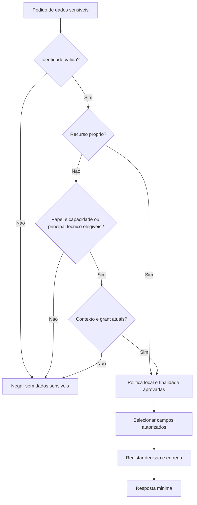

# Permissões, segurança e privacidade dos perfis

**Estado: política alvo com controlos próprios e de relações parcialmente implementados.** Não é uma conclusão jurídica sobre todos os tratamentos do GoLeve e não autoriza recolha de dados reais nesta fase. Complementa [utilizadores](user-profiles.md), [profissionais/gestão](professional-profiles.md), [relações](profile-relationships.md) e a decisão de [utilização autónoma](autonomous-use.md). As permissões futuras na matriz não equivalem a endpoints já disponíveis.

## 1. Factos atuais e lacunas

**Atualização Fase 5.10:** o [Management V1](management-v1.md) implementa
perfis operacionais, âmbitos canónicos de serviços, atribuições com aprovação
independente e prazo finito, casos, auditoria e contratos internos por
proprietário. Auth tem convites para novas contas Gestor, sem promoção de
contas existentes. O provisionamento inicial de administradores, autoridade
real de elegibilidade e prontidão produtiva continuam pendentes. A API atual
está em [Management V1](../api/management-v1.md); referências abaixo a estas
funcionalidades como futuras pertencem à proposta original.

O Auth valida JWT e consulta o próprio utilizador em MongoDB; o papel atual é lido da conta. O User aplica titularidade, validação, cifra e auditoria aos dados próprios; o Professional aplica controlos às candidaturas, revisão simulada e metadados de relações. Não estão implementados grants por dataset, acesso sensível delegado, endpoint administrativo de atribuição de papel ou estado de conta/sessão revogável.

O gateway encaminha Auth, User, Professional, Management e relações; cada proprietário aplica os seus controlos. Training, Agenda, Hydration, Payment e AI Coach ainda só têm saúde. O contrato técnico Auth–Professional é limitado a fixtures da demonstração, com credencial própria e bloqueio em produção; não é uma identidade técnica ou introspeção genérica para produção. Ver [demonstração](../api/isolated-demo.md). Bases lógicas distintas não provam credenciais isoladas ou TLS/ACLs de produção; a cifra de payloads sensíveis do User já existe no âmbito fictício, sem provar implementação integral desta política.

Nenhum papel, claim JWT, segredo ou campo é criado nesta revisão documental. O modelo escalar userType permanece inalterado; percursos autónomo/acompanhado/misto e ambientes de treino não são papéis.

## 2. Regra de decisão

**Deny por defeito.** Uma leitura/escrita só é permitida quando se verificam todas as condições aplicáveis:

1. Identidade autenticada atual e serviço chamador autorizado.
2. Ação permitida ao papel global, sem confiar em `role`, `userType` ou IDs livres enviados pelo cliente.
3. Propriedade do recurso ou relação/grant explícitos para dados de outro titular.
4. Capacidade profissional verificada, válida para atividade/jurisdição, sem suspensão.
5. Relação aceite e não suspensa/encerrada.
6. Grant válido para o destinatário, finalidade, dataset, campos, período e ação.
7. Base de tratamento, transparência, restrições de utilização e retenção aprovadas para o caso.
8. Política adicional do serviço proprietário, incluindo âmbito organizacional e segredo profissional quando aplicável.
9. Auditoria e DTO mínimo da resposta; operações sensíveis não prosseguem sem os controlos obrigatórios.

Identidade não implica papel privilegiado; papel não implica capacidade profissional; capacidade não implica relação; relação não implica grant; grant não determina, por si, uma base legal.

As condições 4–6 são condicionais ao contexto profissional/delegado. Gerir recursos próprios não exige ginásio, relação, capacidade profissional, contratação, pagamento ou IA. Aplica-se autenticação, titularidade, política local e demais condições pertinentes; não um grant ao próprio. Um profissional a atuar sobre dados alheios não pode invocar o percurso autónomo para evitar os controlos. Indisponibilidade dos opcionais não deve bloquear operações exclusivamente próprias.

O `GET /auth/me` atual pode validar identidade dos pedidos humanos nas primeiras fases sem dar o segredo HS256 a todos os serviços. Descartar campos de identidade desnecessários e não guardar o Bearer. A futura identidade de serviços/background jobs requer contrato próprio; não usar um JWT inventado em nome do titular.

O diagrama representa dados sensíveis, não uma autorização clínica para operações de suporte. O contexto inclui relação profissional quando aplicável ou tarefa de serviço autorizada. O ramo de recurso próprio não dispensa restrições legais, proteção de conteúdo de terceiros ou regras de registos profissionais.

## 3. Matriz de permissões por função

Legenda:

- **Próprio**: apenas recurso da identidade autenticada. Vale para qualquer pessoa que tenha perfil pessoal, independentemente de também ser profissional/gestor/admin.
- **G**: papel profissional + capacidade correta verificada + relação aceite + grant/ação/finalidade/campos válidos + política do proprietário.
- **M**: atribuição Management ativa, permission code e âmbito do recurso. Não é acesso global.
- **A**: fluxo administrativo aprovado, identidade forte, auditoria e separação de funções quando aplicável; autoridade final do serviço proprietário.
- **T**: identidade técnica AI, tarefa delimitada, grant atual e contexto mínimo aprovado; não um papel humano.
- **—**: negado no acesso normal. Exceções legais têm processo separado, não um wildcard administrativo.

| Ação | Titular | Nutricionista | PT | Gestor | Administrador | Coach IA |
|---|---|---|---|---|---|---|
| Ler diretório profissional público aprovado | Sim | Sim | Sim | Sim | Sim | — por defeito |
| Ler identidade de autenticação | Próprio | Próprio | Próprio | Próprio | A para gestão de conta, sem hashes | — |
| Atualizar perfil pessoal/preferências | Próprio | Próprio | Próprio | Próprio | Próprio | — |
| Gerir objetivos, hábitos e medições próprios | Próprio | Próprio | Próprio | Próprio | Próprio | — |
| Gerir treino autodirigido e hidratação próprios (futuros) | Próprio | Próprio | Próprio | Próprio | Próprio | — |
| Gerir agenda pessoal sem profissional (futura) | Próprio | Próprio | Próprio | Próprio | Próprio | — |
| Ler contactos de outro titular | — | G, mínimo necessário | G, mínimo necessário | M apenas para tarefa operacional aprovada | — por função | — |
| Ler medições físicas de outro titular | — | G | G | — | — | T, se aprovado para a tarefa |
| Acrescentar medição de outro titular | — | G e autoria registada | G e autoria registada | — | — | — |
| Ler declarações de saúde de outro titular | — | G, campos relevantes | G, apenas limitações/restrições necessárias ao treino | — | — | — por defeito; só exceção de finalidade validada |
| Ler objetivos/hábitos de outro titular | — | G para nutrição | G para treino | — | — | T, grupos aprovados |
| Propor objetivo ao titular | Aceita/ativa o próprio | G, proposta | G, proposta | — | — | Sugestão T, nunca ativação automática |
| Ler/criar plano alimentar profissional | Ler o próprio autorizado | G, capacidade nutrição | — por ser PT | — | — | Sugestão T, não prescrição profissional |
| Ler/criar plano de treino profissional | Ler/aceitar o próprio | — por ser nutricionista | G, capacidade PT | — | — | Sugestão T, não plano profissional aprovado |
| Ler notas de outro profissional | Via interface/direitos aplicáveis, sem promessa de exclusão legal | Só G adicional e necessidade justificada | Só G adicional e necessidade justificada | — | — | — |
| Ler avaliação física profissional | Próprio autorizado | G relevante | G relevante | — | — | T apenas se finalidade aprovada |
| Criar avaliação física | Registo próprio básico é outra entidade | G se competência confirmada | G se competência confirmada | — | — | — |
| Gerir disponibilidade profissional | — | Própria | Própria | M para operação autorizada | — por função | — |
| Gerir agendamentos | Próprios | Próprios e participantes autorizados | Próprios e participantes autorizados | M, sem notas clínicas | — por função | — |
| Verificar credenciais profissionais | — | Não a própria | Não a própria | M revisor, caso atribuído | A/M se revisor formalmente designado | — |
| Suspender elegibilidade de perfil profissional | — | — | — | M e política aprovada | A | — |
| Atribuir papéis globais/administrador | — | — | — | — | A no Auth, sem autoaprovação | — |
| Emitir/revogar grant de dados pessoais | Próprio | — | — | — | — por função | — |
| Consultar indicadores operacionais | — | Próprios agregados | Próprios agregados | M, agregados sem detalhe clínico | A, segurança/operacional | — |
| Ler auditoria de segurança | Histórico próprio quando aplicável | Próprio operacional permitido | Próprio operacional permitido | M limitado | A, sem conteúdo clínico | — |

As permissões de gestão de conta/atribuição de papel são **propostas futuras**; não existem endpoints correspondentes no Auth atual. O administrador não recebe hashes, passwords, chaves de encriptação ou saúde em leitura direta por ter o papel mais alto.

Um profissional com duas capacidades precisa da capacidade e grant relevantes para cada ação. Ser gestor e profissional ao mesmo tempo não mistura os contextos; cada pedido declara a finalidade operacional ou de acompanhamento e fica auditado nesse contexto.

O M da linha de contactos permite somente os dados mínimos de uma operação aprovada (por exemplo, resolver um agendamento no âmbito), obtidos por vista autorizada do proprietário. Não dá um endpoint de listagem global de contactos nem acesso direto ao UserProfile de qualquer pessoa.

## 4. Gestor versus administrador

| Tema | Gestor | Administrador |
|---|---|---|
| Âmbito | Serviços/regiões/organizações explicitamente atribuídos | Âmbito administrativo explicitamente aprovado; não confundir com acesso a toda informação |
| Profissionais | Rever casos atribuídos e gerir estados permitidos | Governar processo, designar revisores e intervir por fluxo auditado |
| Agenda | Resolver questões operacionais no âmbito, com dados mínimos | Sem bypass clínico; operações de suporte exigem atribuição/contexto próprio |
| Contas e papéis | Encaminhar pedidos, sem promoção global | Comandos através do Auth, separação de funções e prevenção de autopromoção |
| Configurações | Só chaves operacionais do catálogo e âmbito | Configuração de plataforma não secreta e políticas aprovadas |
| Auditoria | Metadados de operações sob responsabilidade | Metadados de segurança, segregados dos conteúdos clínicos |
| Saúde individual | Sem acesso por função | Sem acesso por função; pedidos legais/incidentes requerem processo específico |

MFA/step-up para funções privilegiadas, bootstrap inicial e aprovação por segundo operador são pré-requisitos de ativação a desenhar, não funcionalidades existentes. Não criar o primeiro administrador através do registo público ou de alteração manual não auditada da DB.

## 5. Registos de política, consentimento e auditoria

### LegalBasisPolicy — proposta de registo governado

Catálogo proprietário do Management, aprovado por responsáveis de privacidade/jurídico; não contém segredos nem transforma uma escolha de UI em base legal.

| Campo | Tipo | Req. | Sens. | Regra |
|---|---|---|---|---|
| `policyId, policyVersion` | string / Int | O | P1 | Identificador estável e versão imutável |
| `purposeCode, dataCategoryCodes` | Enum / Enum[] | O | P1 | Catálogo fechado, categorias limitadas |
| `controllerContext, jurisdictionCodes` | string / string[] | O | P1 | Responsável e países aplicáveis, aprovados |
| `article6BasisCode` | Enum | O | P1 | Seleção juridicamente validada; não default universal |
| `article9ConditionCode` | Enum | C | P1 | Para tratamento de categorias especiais; quando aplicável |
| `consentRequired` | boolean | O | P1 | Resultado da análise, não input livre do operador |
| `noticeVersion, retentionPolicyId` | string / ExternalId | O | P1 | Informação apresentada e retenção |
| `status` | Enum | O | P1 | `draft, approved, retired` |
| `approvedBy, approvedAt, reviewDueAt` | AuthId / Instant | C | P1 | Necessários quando approved; segregação de funções |

Índice único policyId/policyVersion. Versões retiradas não autorizam novos tratamentos. Alterar um catálogo não legitima retroativamente dados já recolhidos.

### ConsentRecord — `consent_records`, proprietário User

Um registo imutável por ação quando a finalidade depender de consentimento; não embutir um histórico ilimitado no perfil.

| Campo | Tipo | Req. | Sens. | Regra |
|---|---|---|---|---|
| `subjectAuthUserId, actorAuthUserId` | AuthId | O | P1/P2 | Titular e interveniente validado; representação é gate específico |
| `purposeCode, dataCategoryCodes` | Enum / Enum[] | O | P1/P2 | Específicos, máximo 20 categorias |
| `legalBasisPolicyId, noticeVersion` | ExternalId / string | O | P1/P2 | Política e informação efetivamente aplicadas |
| `action` | Enum | O | P1/P2 | `granted, withdrawn` |
| `occurredAt` | Instant | O | P1/P2 | Hora do servidor |
| `evidenceMethod` | Enum | O | P1/P2 | `authenticated_ui, verified_offline_process`; não guardar prova civil indiscriminada |
| `supersedesConsentRecordId` | Id | F | P1/P2 | Ligação à decisão anterior, sem a reescrever |
| `requestId` | string | O | P1/P2 | Rastreabilidade técnica, sem tokens |

Índices subjectAuthUserId/purposeCode/occurredAt/_id e requestId único no contexto do titular. Não existe um booleano global `consent=true` que cubra todos os tratamentos. Recolher IP ou fingerprint de dispositivo como prova só se necessidade e retenção forem aprovadas; não por defeito.

### AuditAccessRecord — coleção local em cada serviço proprietário

| Campo | Tipo | Req. | Sens. | Regra |
|---|---|---|---|---|
| `eventId, requestId` | UUID / string | O | P1/P2 | Idempotência e correlação |
| `actorType, actorId` | Enum / string | O | P1/P2 | `user, professional, operator, service` |
| `subjectAuthUserId` | AuthId | C | P2 | Para acesso a dados identificáveis; não necessário em métricas realmente agregadas |
| `resourceType, resourceOpaqueId` | Enum / string | O | P1/P2 | Identificador e classe, sem valores clínicos |
| `actionCode, purposeCode` | Enum | O | P1/P2 | Ação e finalidade efetivas |
| `relationshipId, grantId, policyVersion` | ExternalId / versão | C | P2 | Quando usados na decisão |
| `fieldGroupCodes` | Enum[] | O | P1/P2 | Máximo 30; preferir grupos sem diagnóstico no nome |
| `decision, reasonCode` | Enum | O | P1/P2 | `allowed, denied, unavailable` e motivo codificado |
| `occurredAt, retentionPolicyId` | Instant / ExternalId | O | P1/P2 | Retenção própria, sem histórico eterno |

Índices eventId único; subjectAuthUserId/occurredAt/_id; actorId/occurredAt/_id. Guardar de forma append-only/tamper-evident e com acesso restrito. O Management pode receber uma projeção mínima de segurança; não agrega os conteúdos sensíveis numa base de suporte geral.

Leituras/exportações sensíveis devem criar auditoria fiável antes da entrega, segundo política aprovada. Definir filas/buffers limitados e falha fechada em operações de alto risco se a auditoria obrigatória não puder ser persistida. Auditoria também é dado pessoal e exige retenção e direitos apropriados.

## 6. RGPD: decisões para validação jurídica

O enquadramento exige identificar uma base do artigo 6.º e, quando há categorias especiais, uma condição aplicável do artigo 9.º. Não assumir que um contrato, interesse legítimo ou consentimento resolve todos os contextos. Minimização, finalidade, conservação, direitos e segurança devem ser concretizados por tratamento. Referências: [RGPD, texto oficial](https://eur-lex.europa.eu/eli/reg/2016/679/oj/por) e [texto disponibilizado pela CNIL](https://www.cnil.fr/fr/reglement-europeen-protection-donnees).

O consentimento, quando adequado, deve ser específico e revogável; não se pode substituir retroativamente uma base mal escolhida por outra por conveniência. [CEPD, orientações 05/2020](https://www.edpb.europa.eu/documents/guideline/guidelines-052020-on-consent-under-regulation-2016679_en).

| Tratamento | Desenho técnico proposto | Decisão jurídica pendente |
|---|---|---|
| Conta e segurança | Auth mínimo, credenciais segregadas, logs sem payloads | Base apropriada por finalidade e retenção de segurança |
| Perfil/contactos | Campos facultativos e privados por defeito | Necessidade de cada campo, informação e destinatários |
| Peso, restrições, alergias, notas e inferências | Separação P2 e acesso por contexto | Qualificação dos dados, base e condição aplicáveis, deveres profissionais |
| Verificação profissional | Provas mínimas e revisores limitados | Requisitos por país/atividade, fonte de confirmação e retenção de provas |
| Relação de acompanhamento | Aceitação comercial e grant distintos | Papel da plataforma/profissional e responsabilidade por registos |
| Coach IA | Opt-in de funcionalidade e contexto mínimo, sem treino do fornecedor por defeito | Base por tarefa, fornecedores, transferências, perfilagem e decisões automatizadas |
| Marketing | Separado das notificações funcionais e desligado | Regras de comunicações eletrónicas e prova de escolhas |
| Menores/representantes | Bloqueio de funcionalidades não aprovadas | Política etária, representação, capacidade e garantias adicionais |

A necessidade de AIPD deve ser avaliada antes do tratamento, incluindo categorias especiais, escala, novas tecnologias e perfilagem. Se houver risco elevado residual, avaliar consulta prévia. [CNPD: AIPD](https://www.cnpd.pt/organizacoes/outras-obrigacoes/avaliacao-de-impacto/).

Validar ainda EPD/DPO quando aplicável, obrigações profissionais e legislação nacional, procedimentos de incidente, contratos de subcontratação e transferências internacionais. Um parecer jurídico deve aprovar políticas concretas, não apenas este diagrama.

## 7. Minimização e proteção física

### Separação

- Perfil pessoal/contactos P1, declarações de saúde P2, medições P2, credenciais profissionais e registos de acompanhamento são coleções diferentes, com projeções distintas.
- O esquema não exige guardar tudo para usar a plataforma; nascimento/género/telefone/localização são facultativos até haver necessidade validada.
- Não recolher GPS, morada residencial, documentos civis, fotografias corporais, biometria ou dados de saúde mental por extensão implícita deste desenho.
- Sem pesquisas globais por doença/alergia/peso e sem contactos no diretório, salvo contactos profissionais aprovados.
- IDs, datas, presença em consulta e taxonomias também podem revelar informação sensível; não considerar que retirar o nome anonimiza os dados.

### Encriptação e tipos de armazenamento

Propor TLS entre cliente/serviços/DB/broker/object store, encriptação em repouso de volumes/backups e contas técnicas distintas por serviço. Para conteúdos sensíveis, usar encriptação autenticada na aplicação com chave gerida fora da DB, por domínio/finalidade, acesso mínimo e rotação auditada.

Os tipos dos outros documentos são **tipos de domínio/API**. A representação persistida dos campos abaixo é `EncryptedValue<T>`: um subschema Mongoose de `ciphertext, iv/nonce, authenticationTag, keyId, algorithmVersion`. Validar T antes de cifrar e depois de decifrar; não inferir o DTO público diretamente do documento persistido.

| Campos de domínio | Tipo lógico | Representação de persistência proposta |
|---|---|---|
| BodyMeasurement.value | Int | Envelope encriptado no campo value; sem cópia numérica em claro |
| UserGoal.target.value / tolerance | number / number opcional | Envelope por valor ou payload único validado, decidido antes do schema físico |
| HabitProfile.usualSleepMinutes / activityLevel / exerciseDaysPerWeek / hydrationHabit | Int / Enum | Payload de hábitos encriptado; metadados mínimos de sujeito/versão separados |
| WellbeingEntry.sleepMinutes | Int | Envelope encriptado |
| HealthDeclaration.description e metadados clínicos não necessários à pesquisa | Texto/estrutura validada | Envelope; apenas subject/kind/status/datas estritamente necessários nos índices |
| ProfessionalCredential.registrationNumber | string | Envelope + HMAC de igualdade para controlo de alegações, não hash simples de número previsível |
| Notas, planos alimentares, avaliações, mensagens/contextos IA | Estruturas com formatVersion | Envelopes encriptados, sem uma cópia de debug em claro |

IDs de sujeito, tipos e datas necessários aos índices continuam metadados restritos protegidos pelo acesso e pela encriptação de armazenamento. Não prometer cifragem pesquisável indiscriminada nem indexar ciphertext aleatório como se fosse o número original. Deve ser aprovada uma única opção física de envelope por schema antes de programar; não há duas fontes autoritativas.

Fotos e documentos ficam em object store privado, com download temporário autorizado, classificação por finalidade, deteção de formato e malware. Um comprovativo profissional nunca usa a mesma URL pública que uma fotografia de diretório.

Gestores/administradores de operações não recebem chaves de decifragem por função. Separar administração de infraestrutura, gestão de chaves e acesso clínico, com mecanismos de emergência específicos e auditados se juridicamente exigidos.

## 8. Retenção, exclusão, exportação e correções

Não definir um prazo universal arbitrário para todos os dados de saúde. A tabela é uma proposta de **mecanismos**, com duração aprovada por finalidade antes da implementação.

| Categoria | Comportamento a desenhar | Condição de saída |
|---|---|---|
| Perfil/preferências | Encerramento restringe acesso e inicia pedido de exclusão por ID | Política e direitos avaliados; sem cópia eterna em histórico |
| Medições/objetivos/hábitos | Exportação e correções rastreáveis; eliminação/minimização quando adequada | Rever dependências das projeções e registos sujeitos a conservação |
| Registos profissionais | Finalização/retificação e possível arquivo restrito | Prazo e fundamento profissional/nacional validados; sem continuação automática de acompanhamento |
| Provas de credenciais | Eliminar ficheiros brutos quando a finalidade termina e conservar só o necessário | Requisitos de verificação/recurso e retenção aprovados |
| Convites e grants | Expiração avaliada na decisão; manter o mínimo de histórico necessário | Sem TTL que elimine prematuramente a prova de revogação |
| Prompts/caches IA | Efémeros por defeito; apagar contextos revogados; sem treino de modelos por defeito | Política de fornecedor e de retenção confirmada; não transformar cache em arquivo clínico |
| Auditoria | Metadados mínimos segregados | Retenção de segurança aprovada, acesso e exclusão compatíveis com obrigações |
| Filas/DLQ/backups | Conteúdo mínimo, retenção limitada e acesso restrito | Plano de expurgo/restauro e testes de reintrodução de dados eliminados |

`RetentionPolicy`, catálogo governado no Management: `policyId/version, purposeCode, resourceType, durationRule, triggerCode, allowedArchiveReasonCodes, status, approvedBy/At, reviewDueAt` O. Duração só fica ativa depois de aprovação; não aplicar TTL genérico enquanto houver decisões pendentes.

`DataRightsRequest`, processo restrito coordenado pelo Management: `requestId, subjectAuthUserId, verifiedRequesterId, requestType(access/rectification/erasure/restriction/portability), receivedAt, status, deadlinePolicyId, outcomeCodes` O; `completedAt` C. Cada proprietário executa/exporta só os seus dados após autenticação, com manifesto e prova de conclusão; suporte não recebe um dump clínico por defeito.

Exclusão distribuída é workflow idempotente, não cascade MongoDB entre DBs. Um estado deletion_pending bloqueia novos tratamentos do perfil enquanto o processo decorre; não supor que revoga JWT/conta global, pois o Auth ainda não tem esse fluxo. Eventual desativação da conta requer evolução administrativa aprovada.

Após restauro de backup, reaplicar tombstones/restrições antes de reabrir acessos. Pseudonimização/crypto-erasure só contam como eliminação se o modelo de ameaças, metadados remanescentes e irreversibilidade o permitirem; validar antes de prometer anonimato.

Não foram executados pedidos de exclusão, migrações, TTLs, exports ou alterações de dados nesta etapa.

## 9. Coach IA: acesso mínimo por função

| Função proposta | Contexto inicial permitido após autorização | Excluído por defeito |
|---|---|---|
| Motivação/hábitos | Idioma/estilo, objetivo selecionado e resumo de hábitos aprovado | Nome completo, email, telefone, data de nascimento, diagnósticos e notas |
| Hidratação | Objetivo de água selecionado e totais no intervalo autorizado | Dossiê de saúde; condições clínicas sem finalidade/bases e supervisão aprovadas |
| Treino | Objetivo, disponibilidade preferida e restrições de exercício explicitamente selecionadas | Notas nutricionais, dados de outros profissionais, credenciais e contactos |
| Nutrição | Apenas contexto aprovado para a função e âmbito profissional | Acesso automático a alergias/doenças; criação autónoma de uma prescrição profissional |

O contexto é construído no servidor a partir de allowlists versionadas, não de um `sendFullProfile`. Pedidos livres do utilizador ou instruções do modelo não expandem scopes, não criam grants e não chamam ferramentas com permissões superiores.

Não usar dados do GoLeve para treino/avaliação do fornecedor por defeito. Persistência de conversas é opção separada, com finalidade e prazo; não manter raciocínios internos do modelo nem prompts completos nos logs de observabilidade. Avaliar retenção do fornecedor, região de processamento, subcontratantes e resposta a eliminação antes de enviar saúde.

Uma recomendação IA é um resultado inferido com proveniência e versão do modelo, não uma nova verdade clínica nem um plano profissional aprovado. Avaliar necessidade de revisão humana e enquadramento regulatório do caso de uso antes da fase 6.

## 10. Pré-requisitos de implementação e questões bloqueantes

| Decisão | Quem deve validar | Antes de |
|---|---|---|
| Inventário de finalidades/bases, responsabilidades plataforma-profissional e informação ao titular | Jurídico/privacidade + produto | Recolher campos P2 ou partilhar dados |
| Países/idade/representação e requisitos de títulos | Produto + jurídico + especialistas habilitados | Onboarding profissional ou menores |
| Matriz, scopes por campo, política de notas e modelo de retenção | Segurança + profissionais + jurídico | Implementar endpoints sensíveis |
| Workflow de papéis, MFA/step-up, bootstrap e segregação de funções | Segurança + responsável de plataforma | Ativar privilégios; não alterar Auth nesta tarefa |
| Envelope físico de encriptação, KMS, DBs/ACLs, RabbitMQ e identidades técnicas | Engenharia + segurança | Persistência sensível e integrações |
| AIPD/necessidade de consulta, EPD e fornecedores IA | Responsável de tratamento + jurídico/privacidade | Produção de funções de saúde/IA aplicáveis |
| Controlo de organizações/tenants e métricas agregadas | Produto + segurança | Gestão com âmbitos multiorganização |
| Prazos de retenção, direitos, backups e eliminação verificável | Jurídico + operações + engenharia | Recolha real com ciclo de vida completo |

A sequência de seis fases está em [user-profiles.md](user-profiles.md). Cada fase exige testes de matriz/IDOR, minimização, revogação e erros em dependências; o detalhe de integração está em [profile-relationships.md](profile-relationships.md).

**Critério de validação de extensões:** preservar os controlos já implementados e aprovar ownership, distinção de contextos próprios/profissionais, grants separados e decisões bloqueantes antes de criar novos contratos, schemas, endpoints, eventos, migrações ou alterações no Auth. A opcionalidade de IA não cria consentimentos nem autoriza processamento; a Fase 4 distingue agenda pessoal de reserva profissional conforme [autonomous-use.md](autonomous-use.md#5-implicações-para-a-fase-4-agenda).

## 11. Decisões aprovadas e implementadas na Fase 5.11

A [matriz administrativa V1](administration-v1.md) concretiza a política de
papéis, bootstrap, MFA, step-up e segregação de funções que o quadro anterior
deixava pendente. A aprovação desta fase não resolve requisitos jurídicos,
retenção institucional, verificação de credenciais reais ou recuperação offline.

Papel global único, sem registo público privilegiado. Mudanças de papel exigem
pedido e aprovação independente, nenhum ator pode ser o alvo. Privilégios de
Administrador exigem sessão persistida e MFA real; operações normais exigem
quórum formado e mutações sensíveis exigem prova exata de utilização única.
O último Administrador ativo com MFA é protegido transacionalmente.

Gestor mantém RBAC + âmbitos canónicos e aprovação independente da Fase 5.10.
Revogação global, suspensão ou perda de papel invalidam acessos e a época das
atribuições anteriores. Reativação/novo papel não restauram essas permissões.
Expiração é efetiva na autorização mesmo antes de uma atualização física do
documento. Administrador não ganha acesso operacional de Gestor implicitamente.

Supervisão profissional acrescenta consulta mínima e suspensão administrativa,
sem aprovação real de credenciais ou reativação. Nenhum destes papéis concede
acesso a saúde, conversas IA ou operações financeiras não autorizadas.
