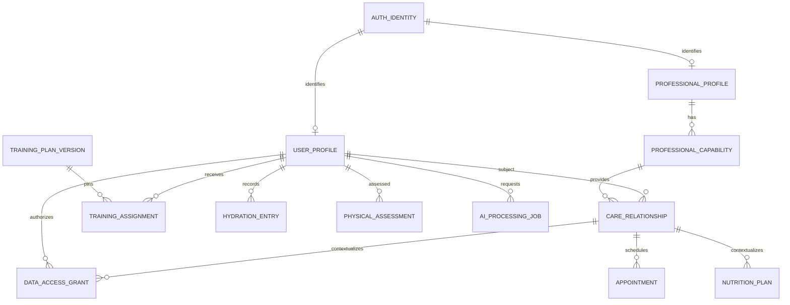
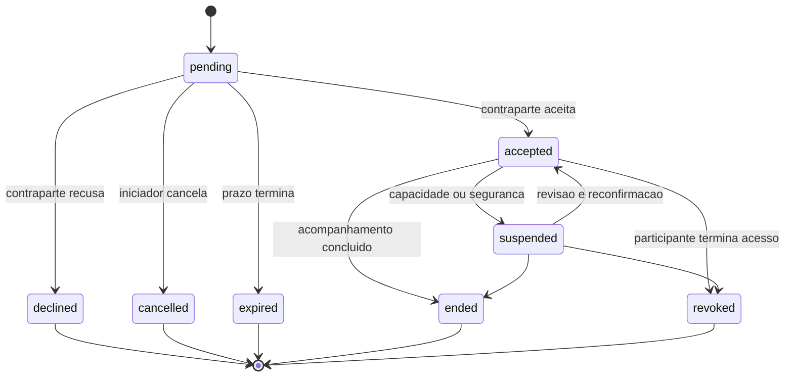
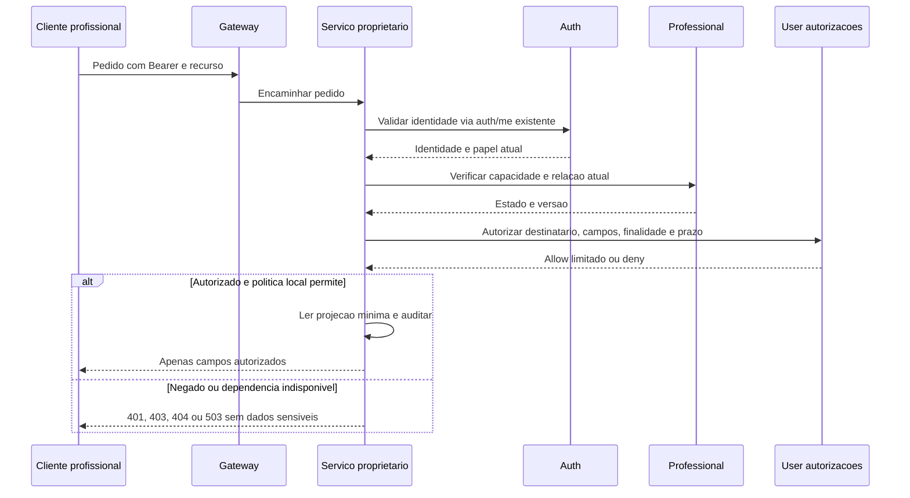

# Relações, integração e ciclo de vida dos perfis

**Estado: desenho proposto, a aguardar validação.** Não existem atualmente relações, grants, eventos AMQP ou schemas destes domínios implementados. Tipos e classificação: [user-profiles.md](user-profiles.md). Perfis/capacidades: [professional-profiles.md](professional-profiles.md). Decisão de acesso: [profile-permissions.md](profile-permissions.md).

## 1. Decisões de arquitetura

1. Auth identifica a pessoa. UserProfile e ProfessionalProfile são entidades diferentes que apontam para o mesmo AuthId quando aplicável.
2. Professional Service é proprietário de **CareRelationship**, o vínculo de acompanhamento de uma atividade específica.
3. User Service é proprietário de **DataAccessGrant**, autorização pessoal para um destinatário/finalidade/dataset. Cada serviço continua a decidir sobre os seus próprios recursos e a aplicar restrições legais.
4. **Aceitar uma relação não concede acesso a saúde.** O registo do vínculo e a decisão de partilhar campos são ações separadas, mesmo que apresentadas no mesmo ecrã.
5. Agenda, Training, Hydration, Performance e AI Coach têm entidades próprias; guardam identificadores de contexto, não duplicam o perfil ou os históricos de outro domínio.
6. Não há transações entre microserviços. Comandos idempotentes, estados explícitos e reconciliação substituem a ilusão de uma escrita distribuída instantânea.

Um grant é uma autorização técnica no produto, não uma conclusão sobre base legal RGPD, propriedade jurídica de registos profissionais ou consentimento. A base legal e o controlo de acesso são condições diferentes.

## 2. Identificadores e cardinalidades

| Relação | Cardinalidade | Autoridade / regra |
|---|---|---|
| AuthIdentity → UserProfile | 1 → 0..1 | authUserId único no User; perfil criado por onboarding explícito |
| AuthIdentity → ProfessionalProfile | 1 → 0..1 | Perfil comum; capacidades nutrição/PT separadas |
| ProfessionalProfile → ProfessionalCapability | 1 → N | Uma por atividade e jurisdição |
| Utilizador ↔ profissional/capacidade | N ↔ N | CareRelationship por vínculo; não limitar automaticamente a um nutricionista/PT |
| CareRelationship → DataAccessGrant | 1 → 0..N | Zero grants é válido, mesmo com relação aceite |
| Profissional → agenda | 1 → N regras/reservas | Agenda gere todos os compromissos da pessoa, inclusive duas capacidades do mesmo profissional |
| Utilizador → planos | 1 → N atribuições | Referência à versão exata; nunca um array ilimitado no perfil |
| Utilizador → AI Coach | 1 → N sessões/tarefas | Não é uma relação profissional nem autorização genérica de saúde |

IDs locais podem ter referências Mongoose dentro da base do mesmo serviço; IDs externos são strings validadas, sem `populate` remoto. Existência, estado e autorização são verificados através de API/contrato do proprietário. Eventos não criam foreign keys automáticas.

As linhas são ligações por ID/vistas entre serviços, não joins diretos. Nem todo treino precisa de profissional: plano autodirigido usa autoria própria, sem inventar uma CareRelationship.

## 3. CareRelationship — `care_relationships`

Proprietário Professional; classificação P2 porque o contexto pode revelar acompanhamento de saúde.

| Campo | Tipo | Req. | Regra |
|---|---|---|---|
| `_id` e campos comuns | Id, timestamps, version | O | ID do vínculo, estável depois do encerramento |
| `subjectAuthUserId` | AuthId | O | Titular, verificado; não aceitar outro titular num pedido próprio |
| `professionalId, capabilityId` | Id | O | Perfil e capacidade locais, coerentes |
| `professionalAuthUserId` | AuthId | O | Resolvido do perfil pelo servidor, não do body |
| `relationshipKind` | Enum | O | `nutrition, personal_training`; compatível com capability |
| `initiatedByAuthUserId` | AuthId | O | Um dos participantes; nunca o papel vindo do cliente |
| `status` | Enum | O | `pending, accepted, suspended, declined, cancelled, ended, revoked, expired` |
| `isOpen` | boolean | O | Derivado: true para pending/accepted/suspended; só servidor escreve |
| `invitedAt, invitationExpiresAt` | Instant | O | Prazo proposto de 7 dias, configurável como decisão de produto |
| `acceptedAt, acceptedByAuthUserId` | Instant / AuthId | C | Obrigatórios em aceitação; aceita a contraparte, não o próprio convite |
| `requestedScopeCodes` | Enum[] | F | Máximo 20 intenções de partilha; não são permissões ativas |
| `termsVersion` | string | O | Condições de acompanhamento apresentadas |
| `closedAt, closedByAuthUserId, closureReasonCode` | Instant / AuthId / Enum | C | Para estado final; motivo codificado, não notas clínicas |
| `authorizationVersion` | Int | O | Incrementada em alterações relevantes; não expande scopes |
| `previousRelationshipId` | Id | F | Recomeço após encerramento cria novo vínculo/histórico |

Índices:

- `subjectAuthUserId, status, createdAt desc, _id desc`.
- `professionalId, capabilityId, status, createdAt desc, _id desc`.
- Único parcial `subjectAuthUserId, professionalId, capabilityId` quando `isOpen=true`.
- `status, invitationExpiresAt, _id` para expiração de convites, sem TTL que apague o histórico.

Convites expirados deixam de poder ser aceites pela validação de tempo, mesmo antes do worker. Antes de criar um novo convite, encerrar o anterior expirado por comando consistente; o índice não compara relógios. Um vínculo de nutrição não autoriza automaticamente treino, mesmo com o mesmo profissional.

### Convites e aceitação

Primeira versão recomendada: utilizador escolhe profissional num diretório público aprovado e inicia o convite. Convites iniciados por profissionais só devem usar uma partilha de identidade autorizada ou convite vinculado ao destinatário, não uma pesquisa pública de contas por email.

Se existirem links de convite, guardar apenas um hash de token aleatório, com expiração e uso único; o token não substitui autenticação/identidade do destinatário. Não persistir links com tokens em logs, calendários ou eventos.

### Histórico — `care_relationship_events`

Um evento imutável por transição: `relationshipId: Id`, `relationshipVersion: Int`, `eventType: Enum`, `actorId: AuthId/principal técnico`, `occurredAt: Instant`, `reasonCode: Enum` e `requestId: string`, O. Não guardar nomes, emails, textos clínicos ou tokens. Índice único `relationshipId, relationshipVersion` e índice `relationshipId, occurredAt, _id`. Mantém o histórico das associações sem arrays crescentes.

O estado accepted representa disponibilidade para acompanhar, não acesso a qualquer dataset. Suspensão/revogação invalida novas decisões de acesso; retomar o vínculo não reativa grants anteriormente revogados.

## 4. DataAccessGrant — `data_access_grants`

Proprietário User. Cada serviço proprietário consulta a decisão atual ao tratar um recurso sensível e pode impor restrições adicionais. O grant não permite à plataforma ignorar deveres aplicáveis a registos clínicos/profissionais.

| Campo | Tipo | Req. | Regra |
|---|---|---|---|
| `subjectAuthUserId` | AuthId | O | Pessoa a quem os dados dizem respeito |
| `recipientType` | Enum | O | `professional, service`; não aceitar um destinatário arbitrário |
| `recipientId` | string | O | ProfessionalId ou principal técnico registado |
| `capabilityId, relationshipId` | ExternalId | C | Obrigatórios para professional; resolver no Professional |
| `contextKey` | string | O | Gerado pelo servidor: vínculo profissional ou funcionalidade IA específica |
| `dataset` | Enum | O | Catálogo fechado, com proprietário, campos e ações abaixo |
| `allowedFieldCodes` | Enum[] | O | Lista explícita, 1–30; nunca `*` ou expansão automática para novos campos |
| `actions` | Enum[] | O | Subconjunto de `read, append, propose`; sem atualização arbitrária ou eliminação delegada |
| `resourceFilter` | objeto | O | Apenas o titular; tipo/métrica e intervalo temporal F; IDs explícitos no máximo 50 |
| `purposeCode` | Enum | O | `nutrition_followup, fitness_coaching, appointment_fulfilment, ai_coaching` |
| `legalBasisPolicyId, noticeVersion` | ExternalId / string | O | Política aprovada para contexto, sem equivaler a consentimento |
| `consentRecordId` | Id | C | Só se aquela finalidade depender de consentimento válido |
| `validFrom, validUntil` | Instant | O | Janela finita; proposta de máximo 90 dias por grant, pendente de produto/jurídico |
| `status` | Enum | O | `active, revoked, expired` |
| `issuedByAuthUserId` | AuthId | O | Titular ou representante validado; representantes ainda não suportados na fase inicial |
| `revokedAt, revokedBy, revocationReasonCode` | Instant / principal / Enum | C | Na revogação; não exigir justificação em texto ao titular |
| `authorizationVersion` | Int | O | CAS/controlo de concorrência e invalidade de decisões antigas |

Classificação P2, incluindo metadados. Índices: `subjectAuthUserId, status, validUntil`; `recipientType, recipientId, status, validUntil`; `relationshipId, status`; único parcial `subjectAuthUserId, recipientType, recipientId, dataset, purposeCode, contextKey` para status active. Antes de substituir um grant expirado, transitar o anterior; um worker atrasado não autoriza acesso nem deve bloquear para sempre uma renovação.

| Dataset proposto | Proprietário dos recursos | Exemplos de campos / ações possíveis |
|---|---|---|
| `user.contact` | User | Nome de apresentação e contacto especificamente selecionado; read |
| `user.measurements` | User | Peso ou perímetros por tipo/intervalo; read ou append com autoria |
| `user.health` | User | Apenas declarações/categorias selecionadas; read, sem listagem global |
| `user.goals` | User | Objetivos selecionados; read ou propose, não ativar no lugar do titular |
| `user.habits` | User | Hábitos selecionados; read |
| `care.nutrition` | Professional | Resumo/plano/registo contextual; read/append/propose, conforme capacidade e política do registo |
| `training.assignments` | Training | Planos/sessões no contexto autorizado; read/append/propose |
| `performance.assessments` | Performance | Avaliações explicitamente selecionadas; read/append por profissional habilitado |
| `hydration.entries` | Hydration | Registos/resumos no intervalo selecionado; read |
| `ai.context` | AI Coach e fontes autorizadas | Só grupos de dados e função expressamente aprovados; não é um grant a toda a base |

Cada namespace tem um contrato de campos exato antes da implementação. O User guarda a autorização pessoal; **não se torna proprietário das bases dos outros serviços**. Registos sob dever de conservação/segredo profissional exigem política própria no proprietário, mesmo que um grant pessoal peça acesso.

Ativar um grant exige identidade, relação/capacidade atual se aplicável, seleção explícita do titular e política de tratamento aprovada. Um profissional, gestor, administrador, evento ou modelo IA nunca se autoatribui o grant.

## 5. Leitura e revogação

O serviço proprietário valida identidade/recursos e **não confia em cabeçalhos de papel enviados pelo cliente ou apenas no gateway**. Para fases iniciais pode usar `GET /auth/me` já existente, descartando nome/email desnecessários da resposta; não distribuir o segredo HS256 do Auth aos novos serviços. Uma interface de introspeção mínima ou migração para chaves assimétricas é evolução separada, não pressuposto já implementado.

Regras de revogação:

1. Revogar um grant no User persiste a decisão e incrementa authorizationVersion antes do ACK; comandos repetidos são idempotentes.
2. Encerrar/suspender uma relação no Professional bloqueia novos acessos profissionais logo na verificação autoritativa do vínculo, mesmo antes de os grants serem atualizados no User.
3. Expiração é avaliada no momento do acesso. Não confiar apenas em TTL, worker, JWT com uma hora de validade ou projeção RabbitMQ.
4. Nenhuma decisão positiva de saúde é servida a partir de cache desatualizada; se os serviços de decisão falharem, devolver indisponibilidade sem payload. Projeções servem UI, não autorizam.
5. Novos pedidos após confirmação de revogação têm de consultar a decisão atual. Pedidos em curso devem revalidar antes de devolver conteúdo ou enviar contexto à IA; cancelamento é best effort, pois não se podem retirar bytes já entregues.
6. Cancelar tarefas IA pendentes, remover caches/contextos e impedir novas submissões. Eliminação em fornecedores externos depende de contratos e APIs verificadas, não de uma promessa de recall impossível.
7. Não apagar automaticamente consultas, planos ou notas por revogar acesso. Eventual conservação legal segue arquivo restrito, finalidade e retenção aprovadas, fora da interface operacional.

Um novo vínculo com o mesmo profissional recebe novo ID e novas autorizações; não ressuscita o histórico de permissões antigo.

## 6. Contratos das integrações

Os seguintes são schemas de fronteira propostos, não implementação completa de treino, agenda ou IA.

### Agenda

| Entidade / campos | Tipos e obrigatoriedade | Integridade e sensibilidade |
|---|---|---|
| AvailabilityRule | `professionalId, resourceCalendarId, timeZone, weekday, startMinute, endMinute, validFrom, version` O; `capabilityId, validUntil` F | P1; horários 0–1439, sem confundir recorrência local com UTC |
| AvailabilityException | `resourceCalendarId, startsAt, endsAt, availability` O; `reasonCode` F | P1; intervalo positivo, não expor razões privadas no diretório |
| Appointment | `subjectAuthUserId, professionalId, capabilityId, relationshipId, resourceCalendarId, startsAt, endsAt, timeZone, status, bookedBy, idempotencyKey` O; `serviceLocationId, cancellationReasonCode` F | P2; `requested, confirmed, cancelled, completed, no_show`; sem anamnese, condição clínica ou tokens de videoconferência em eventos |

Agenda é a fonte da disponibilidade e da agenda. Um calendário de recurso comum impede que a mesma pessoa, com duas capacidades, receba reservas simultâneas. Índices de consulta por profissional/intervalo, titular/intervalo e idempotencyKey no contexto do pedido.

Um índice único no instante inicial **não impede intervalos sobrepostos**. A confirmação precisa de coordenação atómica de reservas/slots ou locks limitados e teste de concorrência. A estratégia concreta, fusos, DST e cancelamentos são gate da fase 4; não declarar o problema resolvido pelo schema.

### Treinos, hidratação e desempenho

| Entidade | Campos de contexto mínimos | Regra de ownership |
|---|---|---|
| TrainingAssignment | subjectAuthUserId, planVersionId, startsOn, status O; professionalId/capabilityId/relationshipId C para prescrição; endsOn/acceptedAt F | Training; estado offered/active/paused/completed/cancelled; versão fixa e autorização explícita |
| TrainingSession | subjectAuthUserId, performedAt, source, idempotencyKey O; assignmentId, durationSeconds, appointmentId F | Training; uma sessão por documento; duração finita não negativa |
| HydrationEntry | subjectAuthUserId, volumeMl, consumedAt, source, idempotencyKey O | Hydration; inteiro positivo, limite técnico validado na fase 5, sem recomendar volumes clínicos |
| PhysicalAssessment | subjectAuthUserId, professionalId/capabilityId/relationshipId, assessedAt, instrumentCode, formatVersion, payloadEncrypted O | Performance; P2, correções versionadas e autoria qualificada |
| ProgressProjection | subjectAuthUserId, metricCode, periodStart, periodEnd, value, sourceVersion, computedAt O | Performance; P2, derivada/reconstruível; sem duplicar autoridade da observação original |

Planos alimentares pertencem ao Professional, planos de treino ao Training, objetivos pessoais ao User, execução ao respetivo serviço. Nunca atualizar um plano já aceite apenas porque o template mudou.

### Coach IA

| Entidade | Campos propostos | Regra |
|---|---|---|
| AIConversation | subjectAuthUserId, purposeCode, memoryMode, createdAt, status O; expiresAt C se temporária | AI Coach; P2; não embebe todo o histórico |
| AIMessage | conversationId, role(user/assistant/system), contentEncrypted, createdAt, expiresAt O; sourceReferenceIds F, máximo 20 | Uma mensagem por documento; sem tokens de autenticação nem texto de ferramentas secretas |
| AIProcessingJob | subjectAuthUserId, purposeCode, grantId, grantVersionAtRequest, status, requestedAt, expiresAt, inputReferenceIds, providerPolicyVersion O | Referências em vez de payload clínico na fila; queued/running/denied/completed/cancelled/expired |
| AIRecommendation | jobId, subjectAuthUserId, generatedAt, modelVersion, outputEncrypted, sourceVersions, status O; reviewedByProfessionalId F | Resultado inferido P2; não se transforma automaticamente em plano/prescrição aprovada |

O serviço IA tem identidade técnica própria, não se faz passar por utilizadores com o segredo HS256. Antes de recolher contexto e antes de chamar o fornecedor, confirma grants e finalidade atuais. Provider/API keys ficam em gestor de segredos; JWT de utilizador não é guardado no job. Regras completas de contexto, memória e privacidade em [profile-permissions.md](profile-permissions.md).

## 7. RabbitMQ e consistência

Eventos propostos:

| Evento | Emissor | Metadados mínimos / consumidor |
|---|---|---|
| `user.profile.changed.v1` | User | subject ID opaco, profileId, version; projeções necessárias |
| `user.measurement.changed.v1` | User | subject ID, measurementId, version; Performance consulta valores sob autorização |
| `professional.capability.changed.v1` | Professional | professionalId, capabilityId, version; diretório/Agenda invalidam vistas |
| `care.relationship.changed.v1` | Professional | relationshipId, version e código de estado; User/Agenda reavaliam contexto |
| `user.access-grant.revoked.v1` | User | grantId, contextKey, authorizationVersion; cancela jobs e invalida cópias |
| `agenda.appointment.changed.v1` | Agenda | appointmentId, version; Notification usa conteúdo de entrega autorizado |
| `training.assignment.changed.v1` | Training | assignmentId, version; vistas autorizadas |
| `hydration.entry.changed.v1` | Hydration | entryId, subject ID, version; totais/progresso autorizados |

Mesmo IDs pseudónimos e contexto de saúde são metadados protegidos. Não enviar email, nome, peso, alergias, notas, prompts, passwords ou tokens na fan-out. Não introduzir `auth.user.registered` como se já existisse; eventos do Auth exigem uma etapa separada aprovada.

Envelope: `eventId: UUID`, `eventType: enum`, `schemaVersion: Int`, `aggregateId: string`, `aggregateVersion: Int`, `occurredAt: Instant`, `producer: service principal`, `correlationId: string` e `payload` mínimo, O. Payload máximo proposto de 16 KiB e contrato versionado. Acesso às filas/exchanges por serviço/finalidade, TLS, retenção curta de mensagens e DLQ, sem DLQ clínica acessível a todos.

### Outbox/inbox e limitação atual

No desenho futuro, cada produtor mantém `outbox_events` na sua base: eventId único, aggregateId/version, envelope, status, attempts, nextAttemptAt, publishedAt F. Cada consumidor mantém `inbox_events` com índice único consumer/eventId e estado/lease. Publicação é at-least-once; consumidores são idempotentes, ignoram versões antigas e reconciliam lacunas. Confirmar a persistência do efeito antes do ACK.

**O Compose atual não configura replica set.** MongoDB standalone não suporta transações multidocumento; não é possível prometer atomicidade entre atualização do agregado, histórico e outbox com a infraestrutura tal como está. [MongoDB: transações](https://www.mongodb.com/docs/manual/core/transactions-production-consideration/).

Gate D08: aprovar replica set/topologia adequada e testes de falha antes de usar outbox em coleção separada e comandos multidocumento. Uma alternativa a estudar é uma fila pendente pequena e limitada no próprio agregado, escrita atomicamente num documento, com backpressure e reconciliação; não é licença para embutir histórico ilimitado. **Nenhuma alteração de infraestrutura é feita nesta etapa.**

Para criação do perfil inicial, não é necessário alterar já o Auth: primeiro onboarding autenticado e idempotente no User. O registo Auth pode existir sem perfil; `GET /users/me` pode informar onboarding necessário. Não introduzir uma dependência síncrona que faça falhar o login por o User Service estar indisponível.

## 8. APIs futuras e contratos de erro

| Proprietário | Operações propostas, ainda não existentes |
|---|---|
| User | `GET/PUT/PATCH /users/me`; preferências/hábitos; recursos paginados de medições, declarações e objetivos; grants próprios |
| Professional | Candidatura/perfil próprio; diretório público aprovado; capacidades e provas; casos de verificação por revisor; relações, consultas e planos nutricionais autorizados |
| Management | Operadores/âmbitos e fila de processos; orquestração administrativa sem escrever na DB dos proprietários |
| Agenda | Disponibilidade, exceções e ciclo de vida de agendamentos |
| Training/Hydration/Performance | Atribuições, execução, ingestões e avaliações através de contratos próprios |
| AI Coach | Criar/cancelar tarefas e sessões autorizadas, sem endpoint de exportação livre do perfil |

Manter `/auth/*` inalterado. Adicionar rotas no gateway só na fase aprovada de cada domínio. Os proprietários verificam a identidade mesmo para chamadas internas; não expor um endpoint interno de autorização sem autenticar o serviço chamador.

Erros propostos: `400` validação; `401` identidade ausente/inválida; `403` ação proibida; `404` recurso inexistente ou cuja existência não pode ser revelada; `409/412` conflito/versão; `429` quota; `503` dependência de autorização indisponível. Sem detalhes de saúde, existência de utentes ou dados de outros profissionais em mensagens.

## 9. Testes de aceitação futuros

- Matriz IDOR: dois utilizadores, dois profissionais e dois âmbitos de gestão; IDs trocados não dão acesso.
- Relação aceite sem grant continua sem acesso; um grant não torna uma capacidade inválida elegível.
- Dois profissionais do mesmo titular têm scopes independentes; o perfil dual exige a capacidade correta.
- Convites não podem ser autoaceites; expiração e aceitação concorrentes respeitam versionamento.
- Revogar um grant/relação impede decisões novas mesmo com JWT válido ou eventos atrasados; caches não reabrem acesso.
- Atualizações fora de ordem não alteram o peso atual incorretamente; retries não duplicam observações, planos ou reservas.
- Indisponibilidade de Auth/User/Professional bloqueia leituras sensíveis, sem fallback permissivo.
- Suspensão/expiração de credencial bloqueia novas operações; retorno ao estado válido não repõe grants revogados.
- Eventos repetidos, fora de ordem ou perdidos são reconciliáveis; provar a atomicidade real da opção outbox escolhida.
- Agenda testa sobreposição de intervalos, duas capacidades do mesmo profissional, fusos e DST.
- IA testa minimização do contexto, injeção de prompt, revogação entre enqueue e execução e proibição de treinar com dados por defeito.

Estes testes são critérios do plano, não resultados obtidos nesta fase documental.
