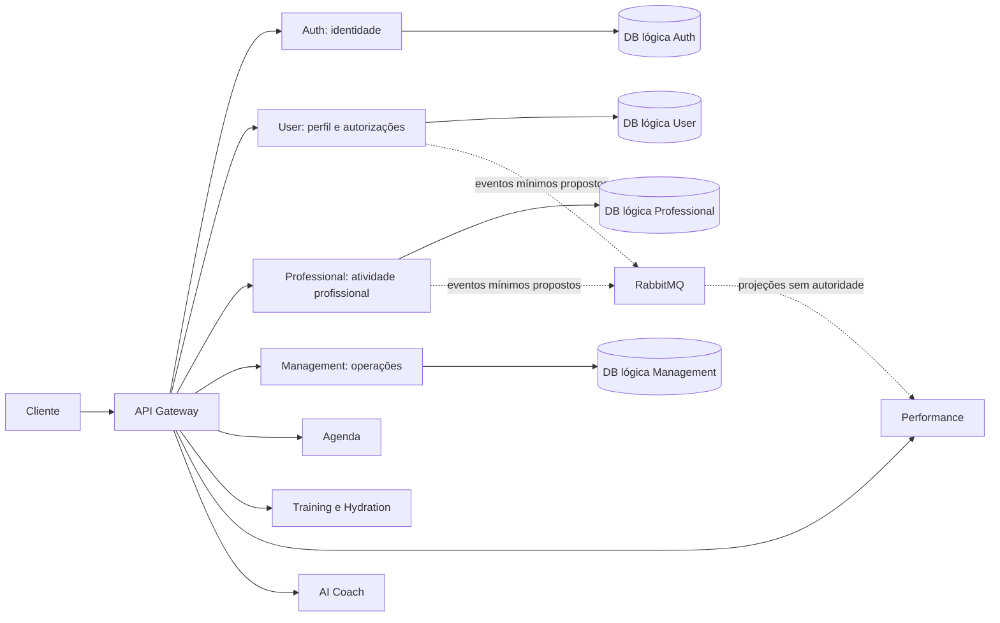

# Perfis de utilizadores: arquitetura e modelo de dados

**Estado: proposta para validação; nenhuma implementação autorizada nesta etapa.**
Análise do repositório no commit `923a8e7`. Este documento, [perfis profissionais](professional-profiles.md), [relações](profile-relationships.md) e [permissões](profile-permissions.md) formam uma única proposta. Não alteram o Auth, os schemas atuais, o Compose ou as bases de dados.

## 1. O que existe e o que falta

| Área | Estado observado no código | Falta implementar |
|---|---|---|
| Monorepo | npm workspaces `api-gateway` e `services/*`; MVC com config, models, controllers, routes, services e middlewares | Contratos de domínio e testes dos novos serviços |
| Auth Service | Único schema Mongoose: `AuthUser` em `auth_users`; ObjectId, name, email único, passwordHash, userType e timestamps | Não há gestão administrativa de papéis, account status, introspeção dedicada nem eventos de identidade |
| Autenticação | Registo, login, `/auth/me`; bcrypt 12; JWT HS256 com subject, issuer, audience e expiração; registo apenas `utilizador` | Autorização por recurso, finalidade e relação profissional |
| User Service | Express em 3002, `/health` e pastas MVC vazias; depende de express/dotenv | Todos os modelos e endpoints deste domínio; ligação Mongoose |
| Professional Service | Express em 3007, `/health` e pastas MVC vazias | Perfis, credenciais, verificação, acompanhamento e registos profissionais |
| Management Service | Express em 3008, `/health` e pastas MVC vazias | Atribuições de gestão, revisão operacional e auditoria administrativa |
| API Gateway | Só encaminha `/auth/*`; limita registo/login; não é um motor de permissões de perfis | Rotas dos novos domínios e composição de respostas públicas/privadas |
| Outros serviços | Training, Agenda, Performance, Hydration, AI Coach, Notification e Payment são estruturas iniciais com `/health` | Modelos de cada domínio e integração; pagamentos continuam simulados |
| MongoDB | Uma instância mongo:7; URIs com bases lógicas distintas; só o Auth estabelece a ligação no código | Contas MongoDB por serviço, proteção de transporte e política de chaves; separação lógica não é isolamento de acesso já implementado |
| RabbitMQ | Broker no Compose e URLs nos ambientes | Não existem clientes AMQP, outbox, consumidores nem eventos implementados |
| Documentação | READMEs curtos de arquitetura, requisitos e eventos; documentação detalhada da autenticação | O presente desenho e a aprovação das decisões pendentes |

Os 85 testes e 14 contentores saudáveis pertencem à etapa anterior. Nesta análise não foram executados testes de aplicações nem operações Docker; um `/health` de estrutura inicial não comprova funcionamento de um domínio ainda inexistente.

### Compatibilidade com o Auth existente

- `auth_users._id`, exposto como `user.id` e no JWT como `sub`, é a identidade estável.
- Nome e email do Auth continuam a servir a identidade de autenticação. O User Service não guarda passwords, hashes, JWT, segredo JWT nem uma segunda credencial de login.
- `UserProfile.displayName` é o nome apresentado no produto, propriedade do User Service; pode ser inicialmente sugerido pelo nome do Auth. São finalidades diferentes, sem sincronização bidirecional automática.
- O email de login mostrado na vista composta vem do Auth, em leitura autorizada, sem uma segunda cópia editável no perfil. `contactEmail`, se necessário, é outro contacto e não altera o login.
- `userType` é hoje um único valor: `utilizador | profissional | gestor | administrador`. Um perfil pessoal e um perfil profissional podem coexistir para a mesma identidade; **ter perfil não atribui papel**.
- Nenhum schema novo repete `userType` como autoridade. Especialidades profissionais e âmbito de gestão não são novos papéis globais.

## 2. Propriedade dos dados

| Proprietário exclusivo | Dados canónicos | Referências ou vistas, sem duplicação autoritativa |
|---|---|---|
| Auth | Identidade, email de login, credenciais, autenticação e papel global atual | Outros serviços usam apenas o identificador e uma decisão de identidade autorizada |
| User | Perfil privado, preferências, hábitos declarados, medições básicas, declarações de saúde, objetivos e autorizações pessoais | Peso atual derivado; identidade lida do Auth |
| Professional | Perfil profissional, capacidades verificadas, credenciais, relações de acompanhamento, registos profissionais e acompanhamento nutricional | Consulta agenda/treinos por identificadores |
| Management | Perfil de operador, atribuições de âmbito, processos operacionais e configuração não secreta | Não substitui a autoridade de papéis globais do Auth |
| Agenda | Disponibilidade real, exceções, reservas, agendamentos e estado de presença | O perfil profissional só publica um resumo de disponibilidade |
| Training | Catálogo/versões de planos de treino, atribuições e sessões executadas | User e Professional não mantêm listas duplicadas de planos ou sessões |
| Hydration | Ingestões de água, lembretes e totais diários derivados | O objetivo pessoal de hidratação vive em UserGoal; a execução vive aqui |
| Performance | Avaliações físicas profissionais e séries derivadas de progresso | Não cria um segundo registo canónico do peso autodeclarado |
| AI Coach | Sessões, mensagens separadas, tarefas e recomendações geradas | Recebe apenas dados aprovados para a tarefa; preferências e autorizações continuam no User |
| Notification | Preferências efetivas de entrega, tentativas e comprovativos de envio | Preferências do utilizador são lidas/versionadas a partir do User |
| Payment | Operações e estados de pagamento simulado | Sem informação clínica em referências de pagamento |

Não há acesso SQL/MongoDB direto à base de outro serviço, `populate` entre serviços, credenciais partilhadas de base de dados ou joins MongoDB entre domínios. Vistas compostas usam APIs autorizadas; projeções assíncronas são identificadas como cópias com origem, versão e prazo de validade.

As setas representam interfaces propostas, não ligações já implementadas.

## 3. Convenções para os schemas futuros

As tabelas são especificações de tipos TypeScript de domínio e schemas Mongoose, não código executável. A persistência coincide com o tipo indicado para campos em claro; os valores definidos na política de encriptação de [permissões](profile-permissions.md) usam um envelope físico encriptado, com DTOs de domínio separados.

| Notação | TypeScript proposto / persistência Mongoose | Regra |
|---|---|---|
| `Id` | string na API; `Schema.Types.ObjectId` como `_id` local | Gerado pelo serviço; não aceitar `_id` do cliente |
| `AuthId` | string / `String` | ObjectId hexadecimal normalizado de 24 caracteres; não `ref` Mongoose ao Auth |
| `ExternalId` | string / `String` | Identificador opaco do serviço proprietário, validado pelo contrato; sem leitura direta da sua DB |
| `Instant` | Date no domínio / `Date`; ISO 8601 UTC na API | Fuso IANA separado para interpretação de horários |
| `LocalDate` | string / `String` | `YYYY-MM-DD` e data de calendário válida; não converter nascimento para meia-noite UTC |
| `Int` | number / `Number` com validação de inteiro finito | Unidades canónicas explícitas; não aceitar NaN/Infinity |
| `Enum` | união literal TypeScript / `String + enum` | DTO recusa valores e campos desconhecidos |
| `O` / `F` / `C` | Obrigatório / facultativo / condicional | Facultativo não significa preencher automaticamente; C identifica a condição na linha |
| `P0` | Público, aprovado para divulgação | Só em DTO público explícito; classificação não decorre de o campo ser uma string |
| `P1` | Dado pessoal privado | Acesso próprio ou delegação limitada; nunca público por defeito |
| `P2` | Informação restrita de saúde, acompanhamento ou inferências | Classificação técnica conservadora; enquadramento jurídico depende do contexto |
| `S` | Segredo ou material de segurança | Apenas no domínio autorizado; não incluir em perfis, eventos ou logs |

Todas as entidades mutáveis têm `_id: Id`, `createdAt: Instant`, `updatedAt: Instant`, `schemaVersion: Int = 1` e `version: Int`, O. A API usa `version` em controlo otimista (ETag/If-Match); `__v` interno não é um papel nem campo editável. Eventos/observações imutáveis têm `createdAt` e uma nova versão/registo para correções, sem um `updatedAt` artificial. Campos comuns herdam a maior sensibilidade da entidade. Arrays embebidos só para listas pequenas com limite explícito.

Campos facultativos são omitidos quando não existem; `null` só é admitido em comandos de limpeza especificamente previstos. Cada envelope cifrado tem schema próprio e não autoriza payloads `Mixed` arbitrários. Em instâncias futuras, versões de schema e de cifragem são distintas.

IDs de proprietário, autoria, timestamps, metadados de segurança, revisões e decisões de estado são controlados pelo servidor. Um patch de perfil nunca remove `restricted` ou `deletion_pending` por simples alteração do body; estados têm comandos e regras próprias.

Proposta Mongoose transversal: schemas estritos, validators em criação e atualização, projeções/DTOs por finalidade e índices criados por procedimento de implantação controlado. Não aceitar patches MongoDB do cliente, `$set` arbitrário, estados de verificação ou IDs de terceiros por mass assignment.

## 4. UserProfile — `user_profiles`

Um documento privado por identidade. Não é uma página pública nem um prontuário.

| Campo | Tipo | Req. | Sens. | Validação / significado |
|---|---|---|---|---|
| `authUserId` | AuthId | O | P1 | Único, imutável, obtido da identidade autenticada |
| `displayName` | string | O | P1 | Trim, 2–100 caracteres; nome de apresentação |
| `birthDate` | LocalDate | F | P1 | Não futura; recolher apenas se necessária à função aprovada; política etária pendente |
| `gender` | Enum | F | P1 | `mulher, homem, nao_binario, autodescrito, prefiro_nao_indicar`; ausência também é válida |
| `genderDescription` | string | C | P1 | Só se autodescrito, máximo 80; não usar género como variável fisiológica inferida |
| `contactEmail` | string | F | P1 | Email normalizado, máximo 254; não é a credencial de login nem precisa de ser globalmente único |
| `contactEmailVerifiedAt` | Instant | F | P1 | Só o serviço pode marcar após verificação; processo futuro |
| `phoneE164` | string | F | P1 | E.164 validado, sem listas de contactos importadas |
| `phoneVerifiedAt` | Instant | F | P1 | Só processo de verificação; não implementa MFA |
| `photoAssetId` | Id | F | P1 | Referência a UserAsset próprio, disponível e classificado como avatar |
| `countryCode` | string | F | P1 | ISO 3166-1 alpha-2; obrigatório apenas para funcionalidades geográficas aprovadas |
| `approximateLocation.regionCode` | string | F | P1 | Subdivisão/região; sem morada, GPS ou localização contínua |
| `approximateLocation.cityLabel` | string | F | P1 | Máximo 100; dispensar se país/região bastarem |
| `profileStatus` | Enum | O | P1 | `draft, active, restricted, deletion_pending`; estado do perfil, não da conta Auth |
| `onboardingVersion` | Int | O | P1 | Versão do questionário; não implica aceitação de termos ou consentimentos |

A vista `UserIdentityView` acrescenta `identity.id, identity.name, identity.email` lidos do Auth apenas para o próprio. Estes três campos não pertencem ao schema UserProfile e não são alterados em `PATCH /users/me`.

Índices propostos: `authUserId` único; `profileStatus, updatedAt, _id` para processos internos. Nenhum índice público de localização ou data de nascimento por defeito.

### UserAsset — `user_assets`

| Campo | Tipo | Req. | Sens. | Regra |
|---|---|---|---|---|
| `authUserId` | AuthId | O | P1 | Dono autenticado |
| `purpose` | Enum | O | P1 | Inicialmente só `avatar` |
| `objectKey` | string | O | P1 | Chave opaca de armazenamento privado; não URL pública permanente |
| `mimeType` | Enum | O | P1 | Tipos de imagem aprovados, deteção real do formato |
| `byteSize` | Int | O | P1 | Positivo; limite de upload de produto a aprovar |
| `status` | Enum | O | P1 | `pending_scan, available, rejected, deletion_pending` |
| `checksum` | string | O | P1 | Integridade; não usar para localizar fotografias de outros titulares |
| `expiresAt` | Instant | C | P1 | Obrigatório para upload incompleto; retenção final depende da finalidade |

Guardar binários num object store privado; o User Service é proprietário do namespace e do metadado, sem exigir um novo microserviço de media. URLs temporárias são emitidas após autorização. Remover EXIF/geolocalização; não fazer reconhecimento facial. Índice `authUserId, createdAt, _id`; limpeza de uploads incompletos separada de dados finais.

## 5. UserPreferences e CoachPreferences

`user_preferences`: um documento por `authUserId`, índice único. Todas as preferências podem ser omitidas pelo cliente; os valores iniciais são defaults de apresentação, não autorização de tratamentos.

| Campo | Tipo | Req. | Sens. | Regra |
|---|---|---|---|---|
| `authUserId` | AuthId | O | P1 | Obtido do sujeito |
| `locale` | string | O | P1 | BCP 47 numa lista suportada; default de produto proposto `pt-PT` |
| `timeZone` | string | O | P1 | Fuso IANA válido; default explícito confirmado pelo utilizador |
| `theme` | Enum | O | P1 | `system, light, dark`; default system |
| `units.system` | Enum | O | P1 | `metric, imperial`; apenas apresentação, persistência continua canónica |
| `notifications.channels` | objeto booleano | O | P1 | `inApp, email, push`; push exige subscrição separada |
| `notifications.categories` | objeto booleano | O | P1 | `appointments, activity, hydration, security`; marketing separado e desligado |
| `quietHours` | objeto | F | P1 | Minutos de início/fim 0–1439 e dias 0–6; interpretar no fuso |
| `coach.enabled` | boolean | O | P1 | Default false; não equivale a consentimento ou acesso a saúde |
| `coach.style` | Enum | O | P1 | `neutral, supportive, concise`; default neutral |
| `coach.focus` | Enum[] | F | P2 | No máximo 5: `activity, hydration, training, nutrition, habits` |
| `coach.memoryMode` | Enum | O | P2 | `off, session, approved_history`; default off |
| `coach.proactiveSuggestions` | boolean | O | P1 | Default false |

Bases legais, notificações de segurança necessárias e permissões de entrega são avaliadas separadamente das preferências de interface. A seleção `nutrition` não permite enviar alergias ou notas profissionais para IA.

## 6. HabitProfile — `habit_profiles`

Um retrato **autodeclarado** de hábitos, sem o confundir com registos medidos ou agenda.

| Campo | Tipo | Req. | Sens. | Regra |
|---|---|---|---|---|
| `authUserId` | AuthId | O | P1 | Índice único |
| `usualSleepMinutes` | Int | F | P2 | 0–1440; estimativa habitual, não diagnóstico |
| `exerciseDaysPerWeek` | Int | F | P2 | 0–7 |
| `activityLevel` | Enum | F | P2 | `sedentary, light, moderate, high, very_high, unknown` |
| `preferredTrainingWindows` | objeto[] | F | P1/P2 | Máximo 14: dia 0–6, início/fim em minutos e fuso; não reserva horários |
| `hydrationHabit` | Enum | F | P2 | `rarely_tracked, irregular, regular, unknown`; percepção do próprio |
| `declaredAt` | Instant | O | P2 | Data da última confirmação |
| `source` | Enum | O | P2 | `self_reported` nesta fase |

Horas efetivas de sono, se futuramente necessárias, são documentos `WellbeingEntry` separados por observação: `authUserId` O, `localDate` O, `sleepMinutes` F 0–1440, `timeZone` O, `source` O e campos comuns. Índice único `authUserId, localDate` apenas para um resumo diário canónico. Não recolher humor, saúde mental ou dispositivos por extensão automática deste desenho.

## 7. BodyMeasurement — `body_measurements`

Uma observação por documento: peso, altura e perímetros são temporais, não arrays dentro do perfil.

| Campo | Tipo | Req. | Sens. | Regra |
|---|---|---|---|---|
| `authUserId` | AuthId | O | P2 | Titular da observação |
| `kind` | Enum | O | P2 | `weight, height, waist, hip, chest, upper_arm, thigh, calf` |
| `value` | Int | O | P2 | Positivo, inteiro finito; limites técnicos abaixo |
| `unit` | Enum | O | P2 | `g` para weight; `mm` para height/perímetros; compatível com kind |
| `measuredAt` | Instant | O | P2 | Data efetiva; não futura além de tolerância técnica proposta de 5 minutos |
| `recordedAt` | Instant | O | P2 | Hora de receção do servidor, imutável |
| `source` | Enum | O | P2 | `self, professional, device`; device só após integração aprovada |
| `recordedByAuthUserId` | AuthId | C | P2 | Obrigatório para autoria humana; determinado pela autorização |
| `professionalId, relationshipId` | ExternalId | C | P2 | Obrigatórios se source professional, com grant específico |
| `externalObservationId` | string | C | P2 | Só para integração com origem identificada; máximo 128 |
| `sourceSystemId` | string | C | P2 | Obrigatório com externalObservationId; sistema/dispositivo aprovado, namespace de idempotência |
| `idempotencyKey` | string | O | P2 | Evita criação repetida pelo mesmo pedido; máximo 128 |
| `status` | Enum | O | P2 | `valid, superseded, entered_in_error` |
| `replacesId` | Id | F | P2 | Correção de uma observação do mesmo titular e tipo, sem ciclos |
| `correctionReasonCode` | Enum | C | P2 | Obrigatório na correção: `input_error, device_error, professional_correction` |

Limites de integridade propostos, não intervalos de saúde: peso 1–1 000 000 g; altura 1–3 000 mm; perímetros 1–5 000 mm. Validar estes limites com especialistas antes da implementação; valores invulgares não autorizam conclusões clínicas automáticas.

Índices: `authUserId, kind, measuredAt desc, _id desc`; único `authUserId, idempotencyKey`; único parcial `sourceSystemId, externalObservationId, authUserId` apenas quando o identificador externo existe; único parcial `replacesId` quando existe, para impedir duas substituições diretas da mesma observação. Não aplicar TTL ao histórico.

Peso/altura atuais são vistas da observação válida mais recente por `measuredAt`, com desempate estável por ID. Não usar a última mensagem recebida como peso atual. Uma cache opcional guarda `measurementId, sourceVersion, calculatedAt` e pode ser reconstruída; não é uma segunda fonte de verdade. Correções com múltiplos documentos exigem a estratégia transacional descrita em [relações](profile-relationships.md).

## 8. HealthDeclaration — `health_declarations`

Separada do perfil pessoal e das medições. Um documento por informação declarada; sem listas ilimitadas de doenças no UserProfile.

| Campo | Tipo | Req. | Sens. | Regra |
|---|---|---|---|---|
| `authUserId` | AuthId | O | P2 | Dono dos dados |
| `kind` | Enum | O | P2 | `physical_limitation, injury, declared_condition, allergy, dietary_restriction, other` |
| `descriptionEncrypted` | envelope encriptado | C | P2 | Obrigatório se não houver catalogCode; texto lógico máximo 2 000 |
| `catalogCode` | string | F | P2 | Catálogo e versão conhecidos; não exigir codificação clínica do utilizador |
| `catalogVersion` | string | C | P2 | Obrigatório com catalogCode |
| `allergyCategory` | Enum | C | P2 | Para allergy: `food, medication, other, unspecified` |
| `declaredSeverity` | Enum | F | P2 | `unknown, mild, moderate, severe`; declaração, não diagnóstico confirmado |
| `onsetDate, resolvedDate` | LocalDate | F | P2 | Se conhecidas; fim não anterior ao início |
| `status` | Enum | O | P2 | `active, resolved, entered_in_error` |
| `source` | Enum | O | P2 | `self_reported, professional_recorded`; autoria não prova diagnóstico |
| `recordedByAuthUserId` | AuthId | O | P2 | Determinado pelo servidor |
| `relationshipId, professionalId` | ExternalId | C | P2 | Necessários para registo profissional delegado |
| `lastConfirmedAt` | Instant | F | P2 | Confirmação do titular; ausência não permite considerar o dado atual |

Índice `authUserId, kind, status, createdAt, _id`; sem pesquisa global por diagnóstico, descrições ou alergias. Envelope encriptado: `ciphertext, nonce/iv, authenticationTag, keyId, algorithmVersion`; chaves fora da DB. Classificação, metadados e logs continuam pessoais mesmo com payload encriptado.

Não guardar anexos médicos nesta primeira versão. Não converter informação autodeclarada em diagnóstico, prescrição ou capacidade clínica do PT/Coach IA.

## 9. UserGoal — `user_goals`

| Campo | Tipo | Req. | Sens. | Regra |
|---|---|---|---|---|
| `authUserId` | AuthId | O | P2 | Dono do objetivo |
| `goalType` | Enum | O | P2 | `weight_loss, weight_maintenance, muscle_gain, fitness, hydration, daily_activity, custom` |
| `title` | string | O | P2 | 2–120; não público |
| `descriptionEncrypted` | envelope | F | P2 | Texto lógico máximo 1 000; sem duplicar notas clínicas |
| `target.metric` | Enum | C | P2 | `body_weight, water_volume, steps, active_minutes, training_frequency, custom_metric` |
| `target.value` | number | C | P2 | Obrigatório com target; finito e compatível com a dimensão |
| `target.tolerance` | number | F | P2 | Finita, >= 0; não constitui recomendação clínica |
| `target.unit` | Enum | C | P2 | `g, ml, steps, minutes, sessions_per_week` ou unidade custom aprovada |
| `target.period` | Enum | C | P2 | `once, day, week`; obrigatório com target |
| `baselineMeasurementId` | Id | F | P2 | Observação própria e da dimensão adequada |
| `startsOn, targetDate` | LocalDate | F | P2 | Fim não anterior ao início |
| `status` | Enum | O | P2 | `proposed, active, paused, achieved, archived` |
| `createdByAuthUserId` | AuthId | O | P2 | Autoria própria ou profissional autorizado |
| `relationshipId` | ExternalId | C | P2 | Se proposto por profissional; não o torna automaticamente ativo |
| `acceptedAt` | Instant | C | P2 | Ativação de proposta profissional exige aceitação pelo titular |

Peso pretendido é o target do objetivo de peso ativo, não um segundo campo editável em UserProfile. Muscle gain não é inferido apenas de alterações do peso; usar resultado qualitativo ou uma avaliação apropriada no Performance Service. Não publicar metas clínicas ou limites de consumo como recomendações automáticas.

Índices: `authUserId, status, goalType, createdAt, _id`; único parcial `authUserId, target.metric` para objetivo `active` que tenha target.metric, evitando dois alvos ativos contraditórios na mesma métrica. A escolha de permitir múltiplos objetivos da mesma métrica é uma decisão de produto pendente; esta proposta prefere um ativo por métrica.

## 10. Acompanhamento e vista composta

`UserDashboardView` agrega identificadores e resumos autorizados, sem persistir arrays infinitos no perfil:

| Necessidade | Consulta canónica / proprietário |
|---|---|
| Profissionais associados | CareRelationship no Professional, paginação por titular |
| Planos de treino ativos e histórico | TrainingAssignment e TrainingPlanVersion no Training |
| Acompanhamento e planos alimentares | NutritionFollowUp/NutritionPlanVersion no Professional |
| Agenda e consultas | Appointment no Agenda; conteúdo profissional fica no seu domínio |
| Objetivos ativos | UserGoal no User |
| Evolução física | BodyMeasurement no User e PhysicalAssessment/projeções no Performance |
| Água ingerida | HydrationEntry no Hydration |
| Coach IA | AIConversation/AIJob no AI Coach, com autorizações verificadas no momento do uso |

Falha de um serviço resulta em secção indisponível explicitamente identificada, não em uso de uma cópia sem permissões ou de informação clínica desatualizada.

## 11. Atualizações, índices, escala e histórico

- Escritas próprias derivam o titular da autenticação; não aceitam um `authUserId` livre no body. Escritas delegadas usam recurso, relação e grant explícitos.
- Campos editáveis são allowlists por comando. Conflito de versão devolve `409/412`, não last-write-wins silencioso.
- `ProfileChange` é um registo por mudança: `subjectAuthUserId, actorId, resourceId, resourceVersion, changedFieldCodes[], occurredAt, requestId, purposeCode`, O; `reasonCode` F. Classificação P1/P2 conforme recurso, sem valores antigos, passwords ou textos clínicos. Índice `subjectAuthUserId, occurredAt, _id`.
- Medições preservam proveniência e correções. Declarações sensíveis só mantêm revisões de conteúdo quando houver finalidade e retenção aprovadas; não perpetuar toda informação apagada num log.
- Paginação por cursor, ID e instante; limite proposto de 100 documentos por resposta, menor para registos sensíveis.
- Listas crescentes de pesos, avaliações, relações, sessões, mensagens e planos são coleções separadas. O limite de um documento BSON é 16 MiB; a separação também evita contenção e permissões demasiado amplas. [MongoDB: limites](https://www.mongodb.com/docs/manual/reference/limits/).
- Propor índices a partir dos acessos acima; não adicionar índices de dados sensíveis por conveniência. Sharding só após métricas reais, não nesta fase.
- Não criar índices únicos/TTL ou migrar documentos agora. Política de retenção, exportação e eliminação: [permissões e privacidade](profile-permissions.md).

## 12. Implementação faseada, dependências e critérios de aceitação

| Fase | Entrega recomendada | Dependências e saída verificável |
|---|---|---|
| 1 — User | Ligação MongoDB do User; perfil/preferências/hábitos; medições, objetivos e declarações apenas após aprovação de privacidade; autorizações e auditoria mínimas | Validar identidade através do `GET /auth/me` existente, sem copiar o segredo HS256; teste entre titulares, índices, versões, DTOs e prevenção de IDOR |
| 2 — Professional | Perfil comum, capacidades nutricionista/PT, credenciais e workflow de verificação; Management com revisão limitada | Fluxo de atribuição controlada do papel profissional ainda não existe no Auth; aprovação separada antes de ativar atendimento, nunca registo público privilegiado |
| 3 — Relações | Convites, aceitação, scopes, grants, revogação e histórico | Relação não concede acesso; testes de expiração, múltiplos profissionais, revogação e falha fechada |
| 4 — Agenda | Disponibilidade canónica, exceções e reservas/consultas por IDs | Relações e capacidades; fuso/DST, idempotência e prevenção real de reservas sobrepostas |
| 5 — Treinos e Hidratação | Planos versionados, atribuições, sessões, registos de água e Performance | Contratos de propriedade, grants e eventos; correções fora de ordem e projeções reconstruíveis |
| 6 — Coach IA | Tarefas mínimas por finalidade, contexto aprovado, histórico opt-in e auditoria | Bases legais, fornecedores, transferência/retenção e AIPD validadas; bloquear IA se grant expirar ou for revogado |

Dependências transversais: transporte autenticado entre serviços, credenciais por DB/fila, ACLs, outbox/inbox e topology MongoDB apropriada **antes** de prometer atomicidade de eventos. As fases são ordem de implementação futura; nenhuma começa com este documento.

Riscos prioritários: sobreposição de propriedade do nome/email; confundir perfil profissional com papel; duplicação de histórico; acesso sensível por JWT válido mas sem grant; projeções antigas após revogação; introdução de IA antes da avaliação de privacidade.

## 13. Decisões pendentes

| ID | Decisão necessária | Bloqueia |
|---|---|---|
| D01 | Países e idade mínima de lançamento; menores excluídos até política expressa aprovada | birthDate, verificação profissional, saúde |
| D02 | Obrigatoriedade real de nascimento, género, telefone, localização e fotografias | Contratos do perfil e onboarding |
| D03 | Autoridade de cada finalidade e bases legais, retenção e direitos | Campos P2 e partilha |
| D04 | Processo administrativo de papéis e separação de funções; eventual evolução do userType escalar | Profissional/gestor/administrador ativos |
| D05 | Validar ownership proposto de relações no Professional e grants pessoais no User | Fase 3 e serviços consumidores |
| D06 | Limites de dados/objetivos e regras de confirmação por profissionais habilitados | Medições, treino, nutrição |
| D07 | AIPD, fornecedores IA, object store, gestão de chaves e operação de exclusão | Saúde, documentos e IA |
| D08 | Estratégia MongoDB transacional, eventos e identidade técnica dos serviços | Atomicidade e integrações fiáveis |

Decisões específicas adicionais constam nos outros três documentos. A aprovação do desenho não autoriza alterações retroativas no Auth, migrações ou recolha de dados reais.
