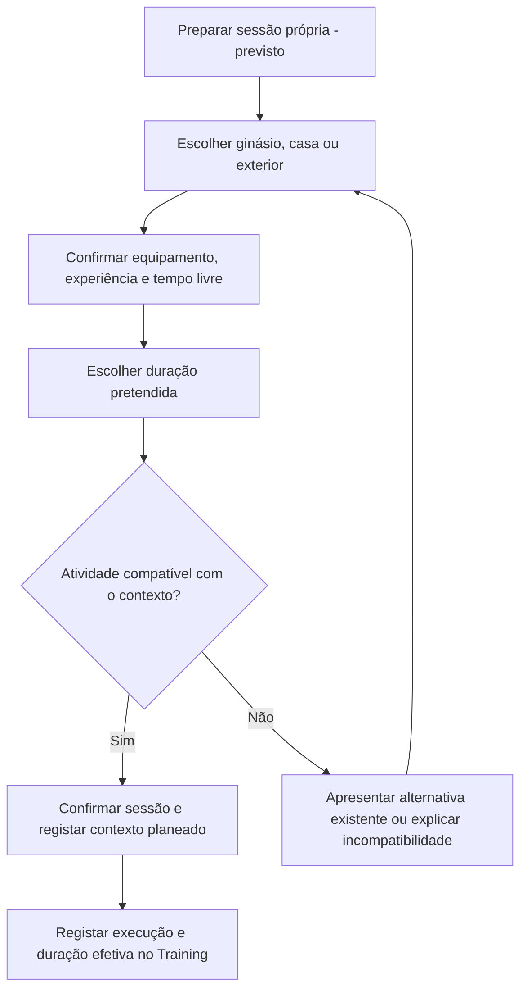
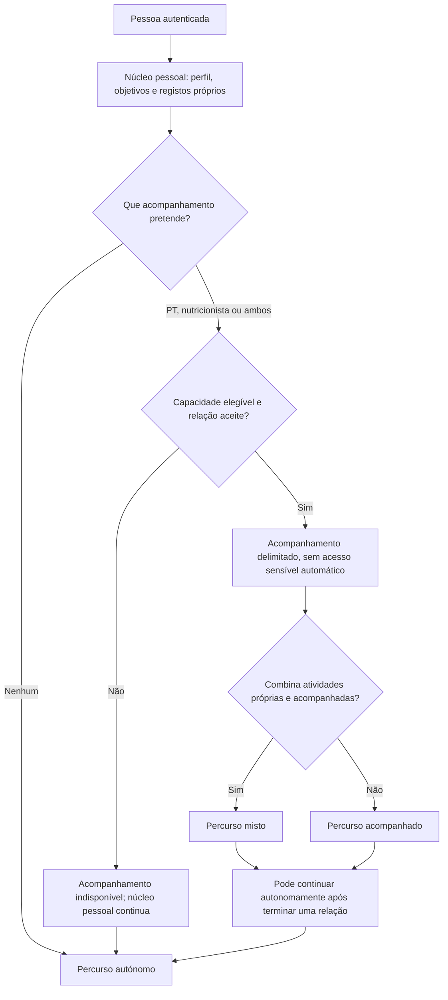

# Utilização autónoma e serviços opcionais

**Estado:** regras de negócio definidas nesta etapa; funcionalidades futuras sujeitas a desenho e implementação próprios. Não representa uma entrega de Training, Agenda, Hydration, Payment ou AI Coach. Estado técnico e conflitos: [arquitetura](../architecture/autonomous-use.md).

## 1. Regras funcionais

| ID | Regra definida |
| --- | --- |
| AUT-01 | O GoLeve pode ser utilizado sem ginásio, PT ou nutricionista. O onboarding pessoal não exige inscrição, identificação de ginásio ou seleção de profissional. |
| AUT-02 | O utilizador pode gerir o próprio perfil, objetivos, hábitos, medições, hidratação, treinos e agenda pessoal. Cada domínio tem o seu estado de implementação; esta regra não declara os domínios futuros disponíveis hoje. |
| AUT-03 | Os ambientes de treino são **ginásio**, **casa** e **exterior**; exterior inclui rua, parque e espaço aberto. Não pressupor equipamento em nenhum deles. |
| AUT-04 | As preferências admitem vários ambientes. O ambiente de uma sessão pode diferir das preferências e da sessão anterior, mediante escolha do utilizador. Não existe ambiente global imutável. |
| AUT-05 | A preparação do treino considera equipamentos efetivamente disponíveis no contexto, experiência declarada, tempo livre e duração pretendida. Ausência de informação não prova inscrição, experiência ou equipamento. |
| AUT-06 | Não ter equipamento é uma situação válida. Uma atividade que exige material indisponível não deve ser apresentada como imediatamente executável; oferecer uma alternativa compatível quando existir, ou explicar a incompatibilidade. |
| AUT-07 | Tempo livre é a janela disponível; duração pretendida, duração planeada e duração efetiva são conceitos distintos. O utilizador pode escolher uma sessão mais curta do que a janela, sem ocupar automaticamente todo o tempo livre. |
| AUT-08 | Acompanhamento opcional: **nenhum**, **PT**, **nutricionista** ou **ambos**. Não são papéis Auth, planos comerciais nem uma restrição a um único profissional por atividade. |
| AUT-09 | Iniciar, recusar ou terminar acompanhamento não elimina o perfil, objetivos ou registos pessoais nem impede a continuação autónoma. Registos profissionais e permissões mantêm regras próprias. |
| AUT-10 | Acompanhamento exige elegibilidade atual e relação aceite; acesso a dados exige ainda autorização específica aplicável. Escolher um serviço, aceitar uma relação ou declarar um ambiente não concede acesso sensível. |
| AUT-11 | Contratação, preços e pagamentos ficam para uma fase futura. Não assumir gratuitidade, assinatura, comissão, preço, cobrança ou contratação concluída a partir de um pedido de acompanhamento. |
| AUT-12 | A IA é opcional e não é pré-requisito de qualquer percurso. Esta etapa não define nem implementa consentimentos específicos de IA, processamento de contexto ou recomendações automáticas. |

Estas regras não levantam os limites de desenvolvimento local com dados fictícios, nem os bloqueios de privacidade ou elegibilidade existentes.

## 2. Ambientes e contexto de cada sessão

| Ambiente | Exemplos de contexto válido | O que não se pode inferir |
| --- | --- | --- |
| Ginásio | Sessão escolhida pelo próprio nesse ambiente, só com material confirmado | Inscrição ativa, acesso a todas as máquinas ou relação com um PT |
| Casa | Treino sem equipamento ou com material declarado para essa sessão | Morada, área disponível, máquinas ou presença de profissional |
| Exterior | Rua, parque ou espaço aberto, com contexto escolhido pelo próprio | GPS, percurso rastreado, acesso a aparelhos ou condições do local |

A lista de ambientes preferidos é reutilizável; o contexto escolhido para uma sessão pertence a essa sessão. Alterar preferências ou equipamento disponível para uma sessão futura não reescreve sessões concluídas. Não é necessário recolher morada, coordenadas, contrato de ginásio ou dados de terceiros.

O utilizador pode ajustar o ambiente antes da sessão. Se a alteração tornar o treino incompatível, é necessário reavaliar equipamento e duração; não substituir silenciosamente uma versão de plano profissional. As regras de alteração durante uma sessão já iniciada e de vários ambientes dentro da mesma sessão estão pendentes.

Exemplo fictício: a mesma pessoa prefere casa e exterior, dispõe hoje de 20 minutos sem equipamento e amanhã de 45 minutos num ginásio. A sessão de hoje não exige inscrição ou material; a de amanhã usa apenas o equipamento confirmado. Estes tempos ilustram escolhas, não uma recomendação de duração.

O diagrama especifica comportamento futuro; não é uma integração de treino já executável.

## 3. Percursos

### Autónomo

1. Autenticar-se e criar/consultar o próprio perfil, sem ginásio ou profissional obrigatório.
2. Gerir objetivos, hábitos e medições próprios; escolher contexto de treino quando essa função estiver disponível.
3. Organizar compromissos pessoais, treinos e hidratação nos respetivos domínios, à medida que forem implementados.
4. Continuar sem solicitar acompanhamento, contratação, pagamento ou IA.

Não é criada uma relação fictícia para desbloquear funções pessoais. A ausência de relações é um resultado normal, não onboarding incompleto.

### Acompanhado

1. Manter todas as funções próprias do percurso autónomo.
2. Escolher PT, nutricionista ou ambos, consultar capacidades efetivamente elegíveis e enviar pedidos independentes.
3. Prosseguir apenas após aceitação e validações atuais; apresentar indisponibilidade se não houver capacidades elegíveis.
4. Partilhar apenas os dados especificamente autorizados numa fase futura. Aceitação não desbloqueia peso, hábitos, medições ou objetivos sensíveis.
5. Terminar acompanhamento sem perder o percurso pessoal. Consultas, planos e disponibilidade operacional continuam funcionalidades futuras.

Atualmente o adaptador real não confirma profissionais elegíveis; o percurso positivo acompanhado permanece bloqueado no servidor real. A demonstração não oferece um atalho de aprovação.

### Misto

Combinar atividades autónomas e acompanhamento seletivo: por exemplo, treinos autodirigidos e acompanhamento nutricional, ou sessões pessoais em casa/exterior e sessões de PT autorizadas. O âmbito é definido por atividade/recurso, não por um modo global da conta. Ambos os tipos de acompanhamento podem coexistir sem partilha automática de dados entre profissionais.

Adicionar acompanhamento não transforma sessões próprias anteriores em sessões profissionais. Terminar uma relação não atribui ao utilizador autoria sobre planos profissionais. Aceitação, autoria e versões desses planos mantêm-se separadas.

Este diagrama funcional reúne comportamentos implementados e previstos; o ramo positivo de elegibilidade é futuro no servidor real. Nenhum ramo exige ginásio, pagamento ou IA.

## 4. Critérios de aceitação

São critérios para futuras entregas, não resultados de testes desta revisão documental. Referências técnicas e bloqueios: [estado atual e Fase 4](../architecture/autonomous-use.md).

| ID | Cenário e resultado esperado | Estado atual |
| --- | --- | --- |
| CA-A01 | Dada uma conta normal sem ginásio ou relação, quando cria/consulta perfil e gere objetivos, hábitos e medições próprios, não são exigidos ginásio, profissional ou pagamento. | Backend User implementado no âmbito fictício; onboarding de interface não comprovado |
| CA-A02 | Ao escolher nenhum acompanhamento, a pessoa continua nas funções pessoais disponíveis e não é criada uma CareRelationship. | User não exige relação; percurso de interface previsto |
| CA-A03 | Sem qualquer profissional associado, é possível registar água, gerir treinos e criar/alterar compromissos pessoais quando esses domínios forem entregues. | Hydration, Training e Agenda previstos |
| CA-A04 | Preferências casa + exterior são aceites; uma sessão pode escolher ginásio sem alterar compulsivamente as preferências ou as sessões anteriores. | Previsto |
| CA-A05 | Casa ou exterior sem equipamento não impede o percurso; atividades com material indisponível oferecem alternativa existente ou indicação clara, sem presumir máquinas. | Previsto |
| CA-A06 | Com experiência não informada ou material desconhecido, não são inferidos nível avançado nem disponibilidade de equipamento; pedir só a informação necessária à função. | Previsto; níveis e catálogo pendentes |
| CA-A07 | Numa janela de 40 minutos, uma duração pretendida de 20 não reserva automaticamente 40; a duração efetiva é registada separadamente. | Previsto; política de margens pendente |
| CA-A08 | Ao trocar o contexto de uma sessão planeada, revalidar compatibilidade e preservar versões/autoria; não reescrever histórico concluído. | Previsto |
| CA-A09 | Um pedido a profissional inexistente, suspenso ou não confirmado como elegível é recusado; as funções próprias continuam independentes. | Recusa implementada; fluxos positivos reais bloqueados |
| CA-A10 | PT e nutricionista podem ser escolhidos independentemente; nenhum recebe automaticamente os dados nem as permissões do outro. | Relações e isolamento implementados; partilha específica futura |
| CA-A11 | Num percurso misto, a sessão autónoma não exige relationshipId; uma primeira consulta/sessão profissional pode usar `initial_session` sem relação prévia, enquanto o acompanhamento continuado exige relação `accepted`; a conta nunca é classificada globalmente como acompanhada. | Opção A aprovada; implementação da Agenda Profissional futura |
| CA-A12 | Após terminação ou perda de elegibilidade, não há acesso profissional operacional novo, e a pessoa pode continuar a gerir os seus recursos próprios. Não reabrir relações automaticamente. | Regras de relação/User implementadas; novos domínios previstos |
| CA-A13 | Um compromisso pessoal não exige profissional, capacidade, relação ou estado de pagamento; uma reserva profissional não pode usar o tipo pessoal para evitar os controlos. | Gate da Fase 4 |
| CA-A14 | Indisponibilidade de Professional, Payment ou AI Coach não impede uma operação exclusivamente própria; indisponibilidade de Auth continua a impedir acesso autenticado. | User separado desses serviços; extensão aos domínios futuros por validar |
| CA-A15 | Agenda pessoal considera fuso, mudanças de hora e concorrência sem reservar vagas profissionais; uma janela preferida não é um compromisso confirmado. | Gate da Fase 4; política de sobreposição pessoal pendente |
| CA-A16 | Sem contratação ou IA configuradas, os percursos pessoais disponíveis continuam utilizáveis. Não criar cobranças, administradores, grants ou consentimentos implícitos. | Independência existente; funcionalidades futuras não ativadas |
| CA-A17 | Uma pessoa autenticada pode solicitar uma primeira consulta de nutrição ou sessão inicial de PT sem CareRelationship, desde que o profissional/capacidade estejam elegíveis, autorizados e disponíveis. | Opção A aprovada; Agenda Profissional futura |
| CA-A18 | Uma primeira sessão é identificada como `initial_session`, não cria automaticamente uma CareRelationship e não concede acesso a dados sensíveis. | Regra aprovada; contrato técnico pendente |
| CA-A19 | Uma sessão/consulta pontual pode ser repetida com o mesmo profissional como `one_off_session`, sem limite geral de repetições e sem CareRelationship. | Decisão aprovada; Agenda Profissional futura |
| CA-A20 | Uma marcação de acompanhamento continuado exige CareRelationship `accepted`; não é permitido usar `initial_session` ou `one_off_session` para contornar a relação. | Regra aprovada; gate Professional futuro |
| CA-A21 | Todas as modalidades exigem confirmação manual: começam em `requested`, ocupam temporariamente o slot, e só passam a `accepted` por ação atómica do profissional elegível; recusas/cancelamentos/expirações libertam o slot quando possível. | Decisão aprovada; expiração definida abaixo |
| CA-A22 | Reservas `requested` e `accepted` impedem duplicados e sobreposições no calendário operacional do profissional, sem tornar a Agenda Pessoal dependente. | Regra aprovada; implementação futura |
| CA-A23 | Nenhuma modalidade cria CareRelationship, concede dados de saúde, ou implica contratação/pagamento automático; o histórico e a auditoria são preservados. | Regra aprovada; contratos técnicos pendentes |
| CA-A24 | O servidor calcula `expiresAtUtc = min(createdAtUtc + 24h, startAtUtc - 1h)`; não cria pedidos fora da janela, expira `requested` atomicamente e ignora pedidos expirados nas verificações de disponibilidade, mesmo antes da limpeza. | Expiração aprovada; implementação futura |

O desenho técnico consolidado e os impedimentos para a Agenda Profissional estão em [Agenda Profissional](../architecture/professional-agenda.md). Este documento mantém os critérios funcionais; o novo documento não autoriza implementação, elegibilidade positiva no ambiente principal ou alterações de infraestrutura.

## 5. Decisões que continuam pendentes

- Catálogo e códigos de equipamentos, níveis de experiência, limites técnicos de duração e regras de compatibilidade; não ficam aprovados implicitamente por estes exemplos.
- Tratamento de sessões já iniciadas, vários ambientes na mesma sessão e correções de contexto após execução.
- Política de conflitos entre compromissos pessoais, treinos planeados e futuras reservas profissionais; ver [Fase 4](../architecture/autonomous-use.md#5-implicações-para-a-fase-4-agenda).
- Provisionamento profissional/admin seguro, verificação e autorizações específicas de partilha; a regra de serviços opcionais não resolve esses bloqueios.
- Contratação, preços, pagamentos, cancelamentos comerciais e respetivos direitos; nenhum modelo comercial foi escolhido.
- Disponibilidade real das funções futuras e critérios de privacidade para dados reais. Não implementar consentimentos específicos de IA nesta etapa.
- Tratamento de uma `initial_session` já aceite ou pendente quando outra solicitação temporalmente conflitante é feita.
- Conversão ou imutabilidade entre `initial_session`, `one_off_session` e `follow_up` após aceitação de uma CareRelationship.
- Obrigatoriedade da relação `accepted` na solicitação ou apenas na aceitação de `follow_up`.
- Duração, antecedência mínima/máxima, cancelamento e reagendamento, incluindo conflitos com compromissos pessoais.
- Efeito da perda de elegibilidade profissional ou terminação da relação em reservas futuras já aceites.
- Conteúdo mínimo de sessões presenciais/online, localização, links e política de fusos/DST.
- Contratos internos Professional/Auth, eventos RabbitMQ, outbox, notificações e reconciliação de falhas.
- Limpeza em segundo plano, retries, métricas e alertas para expirações; a disponibilidade deve funcionar corretamente sem depender desse processo.
